# Headfish96 · Software Engineer

실시간 제어 소프트웨어부터 통신 시험 도구, 백엔드와 데이터 시각화까지 개발합니다.

2025년부터 **LIG Defense & Aerospace C4I연구소**에서 근무하고 있습니다.

**[개발자 포트폴리오 →](https://headfish96.github.io/Headfish96/developer.html)** · **[교육·실습 지원 →](https://headfish96.github.io/Headfish96/)**

구현한 기능, 담당 역할, 소프트웨어 구조를 프로젝트별로 정리했습니다.

## Systems & engineering

| 작업 | 담당한 일 | 사례 |
| --- | --- | --- |
| **RTOS / VxWorks** | 미사일 체계 SW 개발, 제어 SW 유지보수·시험평가 | [실무 경험](https://headfish96.github.io/Headfish96/projects/rtos.html) |
| **RS232 통신 모의 프로그램** | PyQt 화면·구조 설계, 시리얼 통신·SQLite·로그 구현과 오류 분석. **저작권 등록** | [설계와 개발](https://headfish96.github.io/Headfish96/projects/serial-simulator.html) |
| **MDS** | 영상·음성·이미지의 시나리오 편집·송신 도구를 ChatGPT·Codex와 개발 중 | [개발 과정](https://headfish96.github.io/Headfish96/projects/mds.html) |

## Inside the code

공개 소스의 진입점부터 데이터 흐름·저장소·외부 연동까지 추적해 그린 아키텍처입니다. 상세 페이지에서 설계 선택과 해당 코드로 이어집니다.

<table>
<tr>
<td width="50%"></td>
<td><strong>PiYou · 상태와 알림을 연결하는 백엔드</strong>  아이·캐릭터 상태 관리, 예약 갱신, 푸시 알림. 팀장 · 기획·발표 · 백엔드·AI <strong>SSAFY 자율 프로젝트 전국 1등</strong>  <a href="https://headfish96.github.io/Headfish96/projects/piyou.html#architecture">구조와 설계 선택 →</a></td>
</tr>
<tr>
<td></td>
<td><strong>CodeHive · 함께 편집하고 실행 결과를 공유하기</strong>  Yjs 공동 편집과 STOMP 메시지 전달의 역할 분리. 기획·발표 · 백엔드 <strong>SSAFY 공통 프로젝트 우수상</strong>  <a href="https://headfish96.github.io/Headfish96/projects/codehive.html#architecture">구조와 설계 선택 →</a></td>
</tr>
<tr>
<td></td>
<td><strong>Argus · 공개 데이터를 지도 위의 정보로</strong>  Next.js API 중계·TLE 캐시, 위성 3D·항공기 2D 렌더링. 프로젝트 개발 · 데이터 처리·지도 UI  <a href="https://headfish96.github.io/Headfish96/projects/argus.html#architecture">구조와 설계 선택 →</a></td>
</tr>
</table>

### Architecture notes

| 프로젝트 | 코드에서 읽을 주제 | 자료 |
| --- | --- | --- |
| **PiYou** | JPA 상태 관리 · 예약 작업 · FCM 알림 | [구조도](https://headfish96.github.io/Headfish96/projects/piyou.html#architecture) · [코드 해설](projects/architecture/piyou.md) |
| **Billage** | 모의 금융 API · 계좌 조회 중계 · 서비스 경계 | [구조도](https://headfish96.github.io/Headfish96/projects/billage.html#architecture) · [코드 해설](projects/architecture/billage.md) |
| **CodeHive** | 공동 편집 · 방별 메시지 · 코드 실행 결과 공유 | [구조도](https://headfish96.github.io/Headfish96/projects/codehive.html#architecture) · [코드 해설](projects/architecture/codehive.md) |
| **Argus** | Next.js API · 캐싱 · 3D/2D 렌더러 전환 | [구조도](https://headfish96.github.io/Headfish96/projects/argus.html#architecture) · [코드 해설](projects/architecture/argus.md) |
| **VelocityOne Tester** | 운영체제별 입력 · 상태 정규화 · WebSocket | [구조도](https://headfish96.github.io/Headfish96/projects/flightstick.html#architecture) · [코드 해설](projects/architecture/flightstick.md) |
| **maknae-order** | 브라우저 OCR · 주문 상태 · 로컬 저장 | [구조도](https://headfish96.github.io/Headfish96/projects/maknae.html#architecture) · [코드 해설](projects/architecture/maknae.md) |
| **모델 세트 전환 연구** | kubectl 배포·준비 대기 · 원본 결과 재집계 | [구조도](https://headfish96.github.io/Headfish96/projects/model-transition.html#architecture) · [코드 해설](projects/architecture/model-transition.md) |

팀 프로젝트의 구조도는 팀 전체 구현을 설명합니다. 개인 담당 역할과 공개 코드에서 확인한 범위를 각 사례에 함께 적었습니다.

## Infrastructure & research

Ubuntu·NVIDIA 드라이버, Kubernetes, Prometheus·Grafana, IPMI 환경을 구성한 경험이 있습니다.

**Kubernetes 모델 세트 전환 공동 연구**에서는 순차 적용·대기와 세트 단위 적용·병렬 대기 프로토타입을 비교했습니다. 모의 Deployment 기반 실험 코드와 원본 결과를 공개했습니다.

[연구 사례](https://headfish96.github.io/Headfish96/projects/model-transition.html) · [코드·실험 기록](https://github.com/Headfish96/tsdo-simulation) · [발표 논문](https://d2j16w31g89z0j.cloudfront.net/site/2026s/abs/0721-ZUPVY.pdf)

한국통신학회 2026년 하계학술대회 · 「전술 임무 단계 이종 AI 모델 세트의 오케스트레이션을 위한 쿠버네티스 커스텀 컨트롤러 설계」

## Experience

| 기간 | 소속·역할 | 주요 업무 |
| --- | --- | --- |
| 2025–현재 | **LIG Defense & Aerospace · C4I연구소** | 미사일 체계 SW 개발·시험평가, 서버 환경 구축 및 플랫폼 아키텍처 검토 참여 |
| 2024.07 입사 | **AWS · Data Center Operations** | 물리 서버 장애 상태 확인 및 장비 교체 |
| 2023.12–2024.05 | **멀티캠퍼스 · SSAFY 프로젝트 실습코치** | 교육생 프로젝트 지원·지도 |
| 2020–2022 | **대한민국 육군 · 통신장교** | 서버 운영, 장애 대응 조율, 저장장치 증설·로그 정책 개선 추진 |

## Technologies

- **Systems & desktop:** RTOS · VxWorks · Python · PyQt · pyserial · SQLite
- **Backend:** Java · Spring Boot · JPA · MySQL · Spring WebClient / WebFlux
- **Infrastructure:** Linux / Ubuntu · Docker · Kubernetes · Prometheus · Grafana · IPMI
- **Web & visualization:** TypeScript · Next.js · Three.js · MapLibre
- **AI & data:** MediaPipe · Unity / C# · pandas · NumPy

개발 과정에 **ChatGPT·Codex**를 활용하고 Claude Code도 사용했습니다. Codex와 함께 로컬 GPU에 EXAONE과 하네스를 설치·적용한 경험이 있습니다.

## Writing & learning

[기술 블로그](https://coder-angrybird.tistory.com/) · [Python 데이터 분석 연구](projects/quant-research.md)

학습 기록 모아보기

- [알고리즘 학습](https://github.com/Headfish96/Algorithm)
- [온라인 저지 풀이](https://github.com/Headfish96/Online-Judge)
- [CS 스터디](https://github.com/Headfish96/CS-Study)
- [TIL](https://github.com/Headfish96/Today-I-Learn)
- [Python 기초 실습](https://github.com/Headfish96/PY4E_Boostcourse)

---

[개발자 포트폴리오](https://headfish96.github.io/Headfish96/developer.html) · [교육·실습 지원](https://headfish96.github.io/Headfish96/)

저장소 링크에는 포크가 포함됩니다. 실무 프로젝트는 공개 가능한 일반 기능과 담당 업무를 소개합니다.
