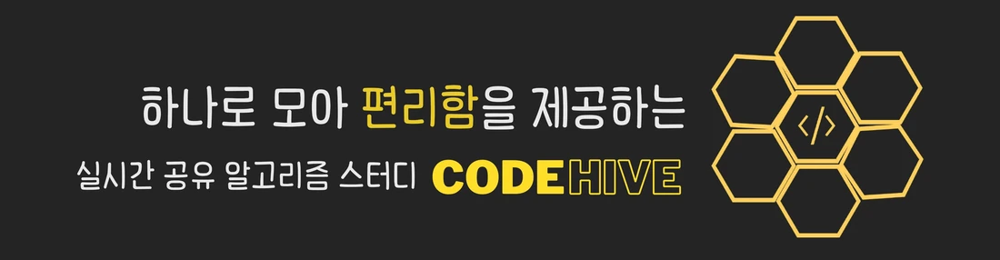
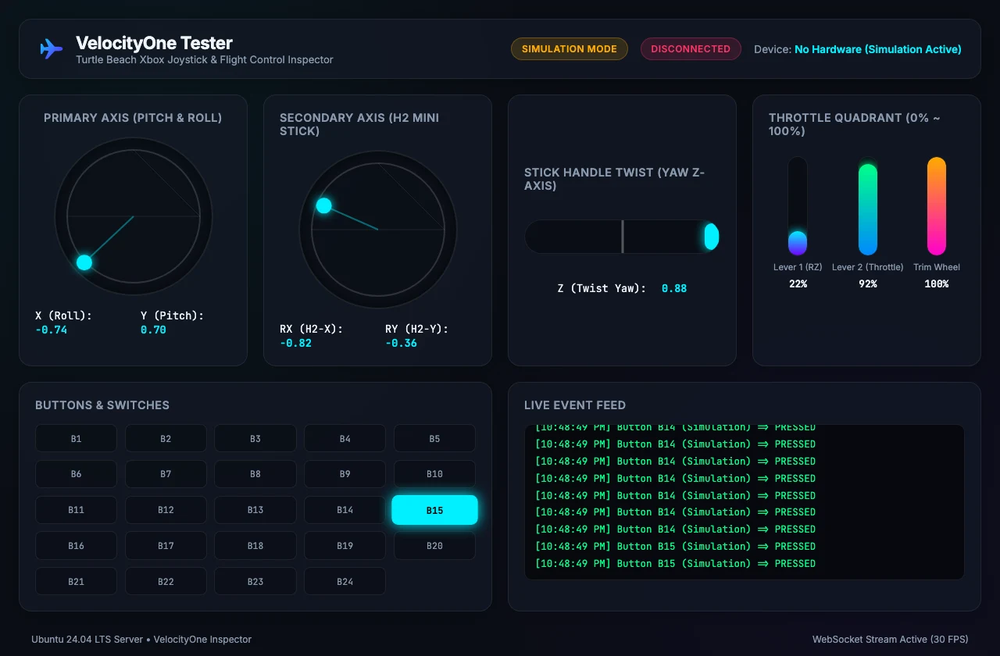

  

# 직접 만들고, 함께 풀어가는 개발자

**Defense Software Engineer · RTOS / VxWorks · Infrastructure · Backend · Applied AI**

VxWorks RTOS 기반 미사일 체계 소프트웨어와 통신 모의 프로그램 개발, 서버 운영·서비스 개발 경험에, 교육생의 프로젝트를 함께 고민한 실습코치 경험을 더했습니다.
새로운 기술을 직접 적용하고, 문제의 원인과 해결 과정을 설명하는 일을 중요하게 생각합니다.

- **현재** · LIG Defense & Aerospace C4I연구소 재직 중 (2025–현재)
- **시스템 SW** · VxWorks RTOS 기반 미사일 체계 SW 개발·유지보수·시험평가
- **교육** · 멀티캠퍼스 SSAFY 프로젝트 실습코치 (2023.12–2024.05)
- **성과** · PiYou, SSAFY 9기 자율 프로젝트 전국 1등 / CodeHive, 공통 프로젝트 우수상
- **AI 활용** · ChatGPT·Codex와 협업해 MDS를 개발 중이며, Claude Code 사용 경험이 있습니다.

**[교육·실습 지원 포트폴리오 →](https://headfish96.github.io/Headfish96/)** · [문서로 보기](docs/teaching.md) &nbsp; · &nbsp; [기술 블로그](https://coder-angrybird.tistory.com/) &nbsp; · &nbsp; [알고리즘 학습](https://github.com/Headfish96/Algorithm) &nbsp; · &nbsp; [CS 스터디](https://github.com/Headfish96/CS-Study)

## 만들고, 설명하고, 함께 해결합니다

**프로젝트 실습코치**로 교육생의 프로젝트 품질 향상을 지원·지도했습니다.
백엔드·인프라·AI 적용 프로젝트와 팀 발표를 경험했고, 현재는 소프트웨어 개발과 서버 환경 구축 경험을 이어가고 있습니다.
교육 현장에서는 수강생의 화면과 오류를 함께 확인하고, 다음 단계를 스스로 진행할 수 있도록 설명하는 방식으로 기여하고자 합니다.

## Selected work

### RTOS / VxWorks — 미사일 체계 소프트웨어 개발

**VxWorks 실시간 운영체제(RTOS)를 활용해 미사일 체계 소프트웨어를 개발**했으며, 제어 SW 유지보수·시험평가도 수행했습니다.
임베디드 제어 콘솔 개발 과정에서는 사용자·관계자의 요구에 대응한 경험이 있습니다.

- **담당 업무:** VxWorks RTOS 기반 미사일 체계 SW 개발, 제어 SW 유지보수·시험평가
- **현장 경험:** 임베디드 제어 콘솔 개발 과정의 사용자·관계자 요구 대응
- **경험의 연결:** 임베디드 시스템 실무를 바탕으로 소프트웨어 동작 확인과 기술 설명에 접근

보안상 소스 코드는 공개하지 않으며, 개발 환경과 담당 업무를 중심으로 소개합니다.

[실무 사례 소개](https://headfish96.github.io/Headfish96/#rtos)

### RS232 통신 모의 프로그램 — 화면·통신·데이터를 함께 설계하기

장비 연동 시험을 위한 **Python·PyQt 데스크톱 통신 모의 프로그램**을 개발했습니다.
화면 구성부터 소프트웨어 구조를 설계하고, 시리얼 송수신·데이터 관리·통신 로그를 연결했습니다.
**「RS232 통신 모의 프로그램」 저작권 등록.**

- **담당 역할:** UX/UI 설계, MVVM 기반 구조 구성, 통신·데이터 처리 구현, 실행 로그를 통한 오류 분석
- **설계:** View·ViewModel 분리, Dispatcher 기반 비동기 통신, Repository·DAO를 통한 SQLite 데이터 접근
- **사용 흐름:** 통신 설정과 포트 제어, 데이터 입력·조회, 송수신 상태·로그 확인, 로그 창 분리·결합
- **문제 분석:** 포트 핸들 오류와 ACK 처리·재전송 순서를 코드 및 실행 로그로 추적
- **설명 경험:** 액티비티·시퀀스·클래스 다이어그램을 작성하고 설계 선택을 설명하는 발표 자료 준비

내부 코드와 통신 규격은 공개하지 않습니다.

[프로젝트 소개](https://headfish96.github.io/Headfish96/#serial-simulator)

### MDS — AI와 협업해 개발 중인 데이터 송신 도구

**Multimodal Data Sender**는 영상·음성·이미지 등의 데이터를 시간축에 배치하고, 시나리오로 편집·저장·송신하는 도구입니다.

- **개발 방식:** 요구사항과 동작을 구체화하고 ChatGPT·Codex의 구현 결과를 확인하며 개선
- **주요 기능:** 시나리오 편집·저장, 미리보기, 입력·시간 구간 사전 검사, 송신과 실행 기록 확인
- **교육과의 연결:** AI에게 작업을 설명하고, 결과를 확인하며 다음 수정으로 이어가는 개발 과정

미리보기·실제 송신·수신 결과 확인은 서로 다른 단계로 구분합니다. 여기에는 일반적인 기능만 소개합니다.

[프로젝트 소개](https://headfish96.github.io/Headfish96/#mds)

### 01 · PiYou — OnDevice AI를 생활 속 서비스로

아동의 식사·양치 습관 개선을 돕는 팀 프로젝트. **SSAFY 9기 자율 프로젝트 전국 1등.**

- **개인 역할:** 팀장, 기획·발표, 백엔드·AI
- **개발 경험:** MediaPipe·Unity 적용, Convex Hull을 활용한 손동작 인식 보완, 사용자 상태 정기 갱신과 JDBC 배치 설정 활용
- **설명할 수 있는 내용:** AI 결과를 서비스 동작에 연결하는 흐름, 낯선 도구의 적용 과정, 백엔드와 앱 사이의 역할

[프로젝트·코드](https://github.com/Headfish96/PiYou) · [팀 소개 영상](https://youtu.be/uulgX3FKP8o)

### 02 · Billage — API 제약을 서비스 설계로 풀기

차용증 생성부터 송금·상환 내역 관리까지 연결한 개인 간 금전거래 서비스.

- **개인 역할:** 팀장, 기획·발표, 백엔드·인프라
- **개발 경험:** 외부 금융 API 이용 제약에 대응한 은행·오픈뱅킹·마이데이터 모의 구현, MSA, Spring WebClient·WebFlux 기반 서비스 통신
- **설명할 수 있는 내용:** API 요청·응답 흐름, 서비스 사이의 책임 분리, 연동 오류의 확인 순서

[프로젝트·코드](https://github.com/Headfish96/Billage) · [팀 소개 영상](https://youtu.be/DxseVqu3nDE)

### 03 · CodeHive — 함께 배우는 환경 만들기

실시간 양방향 코드 편집·채점을 제공하는 알고리즘 스터디 웹 플랫폼. **SSAFY 공통 프로젝트 우수상.**

- **개인 역할:** 기획·발표, 백엔드
- **팀 서비스:** 스터디 생성·일정 관리, 실시간 공유 편집, 코드 채점, 음성통화·자료 공유
- **교육과의 연결:** 학습자가 함께 코드를 읽고 문제를 해결하는 환경을 개발한 경험

[프로젝트·코드](https://github.com/Headfish96/CodeHive) · [팀 소개 영상](https://youtu.be/EHhbgAoXq_k)

## More work · 도구와 데이터 시각화

### Argus — 위성·항공기 공개 데이터 시각화

공개된 궤도·위치 정보를 **3D 지구와 2D 지도**에서 탐색하는 웹 프로젝트입니다.
TypeScript·Next.js·Three.js·MapLibre를 사용해 모드별 렌더러 전환, 위성 위치 계산, 궤도 데이터 요청·캐싱과 지도 표시를 구현했습니다.
외부 데이터의 제공 상태에 영향을 받으며, 공개 소스에서 확인되는 구현 범위로 소개합니다.

[프로젝트 소개](https://headfish96.github.io/Headfish96/#argus) · [코드](https://github.com/Headfish96/argus)

### VelocityOne Flightstick Tester — 하드웨어 입력을 눈으로 확인하기

조이스틱의 축·버튼 입력을 웹 UI에서 확인하는 Python 도구입니다.
Linux 입력 이벤트·축 범위 정규화, macOS 입력 처리, FastAPI·WebSocket 상태 전달과 장치 미연결 시 시뮬레이션 전환을 구현했습니다.
위 화면은 저장소의 **시뮬레이션 모드** 이미지입니다.

[프로젝트 소개](https://headfish96.github.io/Headfish96/#flightstick) · [코드·실행 안내](https://github.com/Headfish96/velocityone-flightstick-tester)

### maknae-order — 식사·카페 주문 정리

여러 사람의 주문과 예산을 정리하는 작은 PWA입니다.
JavaScript·Tesseract.js로 메뉴 사진 OCR, 식사 예산 계산, 카페 메뉴·주문 편집, 브라우저 로컬 저장을 구현했습니다.
사진 선택 후 자동 인식, 큰 이미지 축소, 진행 상태·오류·시간 초과 안내로 사용 흐름을 개선했습니다.

[프로젝트 소개](https://headfish96.github.io/Headfish96/#maknae) · [코드](https://github.com/Headfish96/maknae-order)

## Infrastructure & research

| 작업 | 경험과 자료 |
| --- | --- |
| Kubernetes 모델 세트 전환 연구 | 세트 전환 아키텍처 설계와 순차·병렬 배포 프로토타입 비교. [프로젝트 소개](https://headfish96.github.io/Headfish96/#model-transition) · [코드·원본 결과](https://github.com/Headfish96/tsdo-simulation) |
| 서버 구축·운영 | Ubuntu·NVIDIA 드라이버, Kubernetes, Prometheus·Grafana, IPMI 원격 관리 환경 구성 |
| Python 데이터 분석 연구 | pandas·NumPy를 활용한 백테스트, 비용·실행 시점·현금흐름을 고려한 결과 비교. [연구 소개](projects/quant-research.md) |

**발표 논문:** 「전술 임무 단계 이종 AI 모델 세트의 오케스트레이션을 위한 쿠버네티스 커스텀 컨트롤러 설계」 · 한국통신학회 2026년 하계학술대회 · [원문](https://d2j16w31g89z0j.cloudfront.net/site/2026s/abs/0721-ZUPVY.pdf)

공개 실험 코드는 Python·kubectl 기반 배포 프로토타입입니다. 제안 아키텍처 전체나 실제 AI 모델·KEDA·Argo의 통합 성능을 검증한 구현은 아니며, 실험 조건과 계측 한계는 저장소에 기록했습니다.

## Learning archive

[알고리즘 학습](https://github.com/Headfish96/Algorithm) · [온라인 저지 풀이](https://github.com/Headfish96/Online-Judge) · [CS 스터디](https://github.com/Headfish96/CS-Study) · [TIL](https://github.com/Headfish96/Today-I-Learn) · [Python 기초 실습](https://github.com/Headfish96/PY4E_Boostcourse)

완성 프로젝트와 구분해 학습 과정의 기록으로 연결합니다.

## Experience

| 기간 | 소속·역할 | 경험 |
| --- | --- | --- |
| 2025–현재 | **LIG Defense & Aerospace · C4I연구소** | VxWorks RTOS 기반 미사일 체계 SW 개발·유지보수·시험평가, 서버 환경 구축 및 플랫폼 아키텍처 검토 참여 |
| 2024.07 입사 | **AWS · Data Center Operations** | 물리 서버 장애 상태 확인 및 장비 교체 |
| 2023.12–2024.05 | **멀티캠퍼스 · SSAFY 프로젝트 실습코치** | 교육생 프로젝트 품질 향상 지원·지도 |
| 2020–2022 | **대한민국 육군 · 통신장교** | 서버 운영, 장애 대응 조율, 저장장치 증설·로그 정책 개선 추진 |

## Tools I have used

| 분야 | 기술·도구 |
| --- | --- |
| Backend | Java · Spring Boot · JPA · MySQL · Spring WebClient |
| Infrastructure | Linux / Ubuntu · Docker · Kubernetes · Prometheus · Grafana · IPMI |
| Applied AI & data | Python · pandas · NumPy · MediaPipe · Unity / C# |
| AI-assisted development | ChatGPT · Codex · Claude Code |
| Systems | RTOS · VxWorks · 미사일 체계 SW 개발·유지보수·시험평가 |
| Desktop & integration | Python · PyQt · pyserial · SQLite · MVVM · Repository / DAO |

AI 도구 사용 경험의 범위

ChatGPT·Codex와 협업해 **MDS(Multimodal Data Sender)**를 개발하고 있습니다.
시나리오 편집과 여러 종류의 데이터 송신을 지원하는 도구로, 요구사항을 정리하고 AI의 구현 결과를 확인·수정하며 개발을 진행합니다.
Claude Code도 사용해 봤습니다.
로컬 GPU 환경에 EXAONE과 하네스를 설치·적용한 경험은 Codex의 지원을 받아 진행했으며, 관련 동작과 구성은 학습을 이어가고 있습니다.

---

팀 프로젝트는 서비스 전체 기능과 개인 담당 역할을 구분해 소개했습니다. 링크에는 포크 저장소가 포함됩니다.
