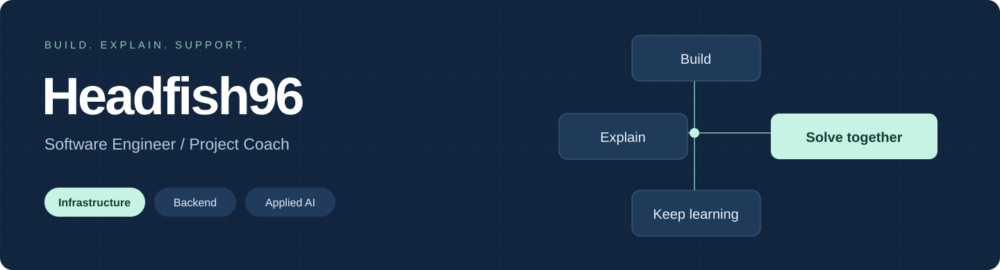

  

# 직접 만들고, 함께 풀어가는 개발자

**Defense Software Engineer · Infrastructure · Backend · Applied AI**

서버를 운영하고 서비스를 개발해 온 경험에, 교육생의 프로젝트를 함께 고민한 실습코치 경험을 더했습니다.
새로운 기술을 직접 적용하고, 문제의 원인과 해결 과정을 설명하는 일을 중요하게 생각합니다.

- **현재** · LIG Defense & Aerospace C4I연구소 재직 중 (2025–현재)
- **교육** · 멀티캠퍼스 SSAFY 프로젝트 실습코치 (2023.12–2024.05)
- **성과** · PiYou, SSAFY 9기 자율 프로젝트 전국 1등 / CodeHive, 공통 프로젝트 우수상
- **AI 활용** · ChatGPT·Codex와 협업해 MDS를 개발 중이며, Claude Code 사용 경험이 있습니다.

**[교육·실습 지원 포트폴리오 →](docs/teaching.md)** &nbsp; · &nbsp; [기술 블로그](https://coder-angrybird.tistory.com/) &nbsp; · &nbsp; [알고리즘 학습](https://github.com/Headfish96/Algorithm) &nbsp; · &nbsp; [CS 스터디](https://github.com/Headfish96/CS-Study)

## 만들고, 설명하고, 함께 해결합니다

**프로젝트 실습코치**로 교육생의 프로젝트 품질 향상을 지원·지도했습니다.
백엔드·인프라·AI 적용 프로젝트와 팀 발표를 경험했고, 현재는 소프트웨어 개발과 서버 환경 구축 경험을 이어가고 있습니다.
교육 현장에서는 수강생의 화면과 오류를 함께 확인하고, 다음 단계를 스스로 진행할 수 있도록 설명하는 방식으로 기여하고자 합니다.

## Selected work

### 01 · PiYou — OnDevice AI를 생활 속 서비스로

아동의 식사·양치 습관 개선을 돕는 팀 프로젝트. **SSAFY 9기 자율 프로젝트 전국 1등.**

- **개인 역할:** 팀장, 기획·발표, 백엔드·AI
- **개발 경험:** MediaPipe·Unity 적용, Convex Hull을 활용한 손동작 인식 보완, 사용자 상태 정기 갱신과 JDBC 배치 설정 활용
- **설명할 수 있는 내용:** AI 결과를 서비스 동작에 연결하는 흐름, 낯선 도구의 적용 과정, 백엔드와 앱 사이의 역할

[프로젝트·코드](https://github.com/Headfish96/PiYou) · [팀 소개 영상](https://youtu.be/uulgX3FKP8o)

### 02 · Billage — API 제약을 서비스 설계로 풀기

차용증 생성부터 송금·상환 내역 관리까지 연결한 개인 간 금전거래 서비스.

- **개인 역할:** 팀장, 기획·발표, 백엔드·인프라
- **개발 경험:** 외부 금융 API 이용 제약에 대응한 은행·오픈뱅킹·마이데이터 모의 구현, MSA, Spring WebClient·WebFlux 기반 서비스 통신
- **설명할 수 있는 내용:** API 요청·응답 흐름, 서비스 사이의 책임 분리, 연동 오류의 확인 순서

[프로젝트·코드](https://github.com/Headfish96/Billage) · [팀 소개 영상](https://youtu.be/DxseVqu3nDE)

### 03 · CodeHive — 함께 배우는 환경 만들기

실시간 양방향 코드 편집·채점을 제공하는 알고리즘 스터디 웹 플랫폼. **SSAFY 공통 프로젝트 우수상.**

- **개인 역할:** 기획·발표, 백엔드
- **팀 서비스:** 스터디 생성·일정 관리, 실시간 공유 편집, 코드 채점, 음성통화·자료 공유
- **교육과의 연결:** 학습자가 함께 코드를 읽고 문제를 해결하는 환경을 개발한 경험

[프로젝트·코드](https://github.com/Headfish96/CodeHive) · [팀 소개 영상](https://youtu.be/EHhbgAoXq_k)

## Infrastructure & research

| 작업 | 경험과 자료 |
| --- | --- |
| Kubernetes 모델 세트 전환 연구 | 세트 전환 아키텍처 설계와 순차·병렬 배포 프로토타입 비교. [코드·원본 결과](https://github.com/Headfish96/tsdo-simulation) |
| 서버 구축·운영 | Ubuntu·NVIDIA 드라이버, Kubernetes, Prometheus·Grafana, IPMI 원격 관리 환경 구성 |
| Python 데이터 분석 연구 | pandas·NumPy를 활용한 백테스트, 비용·실행 시점·현금흐름을 고려한 결과 비교. [연구 소개](projects/quant-research.md) |
| Flightstick Tester | Python 기반 조이스틱 입력 테스트 도구. [코드](https://github.com/Headfish96/velocityone-flightstick-tester) |

**발표 논문:** 「전술 임무 단계 이종 AI 모델 세트의 오케스트레이션을 위한 쿠버네티스 커스텀 컨트롤러 설계」 · 한국통신학회 2026년 하계학술대회 · [원문](https://d2j16w31g89z0j.cloudfront.net/site/2026s/abs/0721-ZUPVY.pdf)

공개 실험 코드는 Python·kubectl 기반 배포 프로토타입입니다. 제안 아키텍처 전체나 실제 AI 모델·KEDA·Argo의 통합 성능을 검증한 구현은 아니며, 실험 조건과 계측 한계는 저장소에 기록했습니다.

## Experience

| 기간 | 소속·역할 | 경험 |
| --- | --- | --- |
| 2025–현재 | **LIG Defense & Aerospace · C4I연구소** | 제어 SW 개발·유지보수, 서버 환경 구축 및 플랫폼 아키텍처 검토 참여 |
| 2024.07 입사 | **AWS · Data Center Operations** | 물리 서버 장애 상태 확인 및 장비 교체 |
| 2023.12–2024.05 | **멀티캠퍼스 · SSAFY 프로젝트 실습코치** | 교육생 프로젝트 품질 향상 지원·지도 |
| 2020–2022 | **대한민국 육군 · 통신장교** | 서버 운영, 장애 대응 조율, 저장장치 증설·로그 정책 개선 추진 |

## Tools I have used

| 분야 | 기술·도구 |
| --- | --- |
| Backend | Java · Spring Boot · JPA · MySQL · Spring WebClient |
| Infrastructure | Linux / Ubuntu · Docker · Kubernetes · Prometheus · Grafana · IPMI |
| Applied AI & data | Python · pandas · NumPy · MediaPipe · Unity / C# |
| AI-assisted development | ChatGPT · Codex · Claude Code |
| Systems | VxWorks 기반 제어 SW 유지보수·시험평가 |

AI 도구 사용 경험의 범위

ChatGPT·Codex와 협업해 **MDS(Multimodal Data Sender)**를 개발하고 있습니다.
시나리오 편집과 여러 종류의 데이터 송신을 지원하는 도구로, 요구사항을 정리하고 AI의 구현 결과를 확인·수정하며 개발을 진행합니다.
Claude Code도 사용해 봤습니다.
로컬 GPU 환경에 EXAONE과 하네스를 설치·적용한 경험은 Codex의 지원을 받아 진행했으며, 관련 동작과 구성은 학습을 이어가고 있습니다.

---

프로젝트는 팀 작업이며 링크에는 포크 저장소가 포함됩니다. 서비스 전체 기능과 개인 담당 역할을 구분해 소개했습니다.
