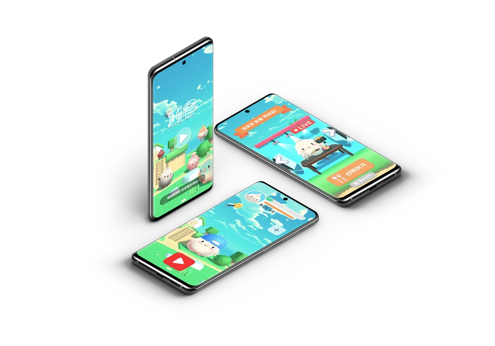

# Headfish96 · Software Engineer

VxWorks 기반 실시간 제어 소프트웨어, 통신 시험 도구, 백엔드 서비스를 개발합니다. 2025년부터 **LIG Defense & Aerospace C4I연구소**에서 근무하고 있습니다.

**[웹 포트폴리오](https://headfish96.github.io/Headfish96/developer.html)** · [GitHub](https://github.com/Headfish96) · [교육·실습 지원](https://headfish96.github.io/Headfish96/)

## 대표 작업

### 01. RTOS / VxWorks · 미사일 체계 소프트웨어 개발

VxWorks 실시간 운영체제를 활용해 미사일 체계 소프트웨어를 개발했습니다.

- **담당 업무:** 미사일 체계 SW 개발, 제어 SW 유지보수·시험평가
- **기술:** RTOS · VxWorks

업무 경험을 중심으로 소개하며 소스 코드는 비공개입니다.

[실무 사례 상세](https://headfish96.github.io/Headfish96/projects/rtos.html)

### 02. RS232 통신 모의 프로그램 · 장비 연동 시험 도구

Python·PyQt를 사용해 통신 설정, 데이터 입력·조회, 송수신 로그를 확인하는 데스크톱 프로그램을 개발했습니다. **「RS232 통신 모의 프로그램」으로 저작권 등록됐습니다.**

- **담당 역할:** UX/UI 설계, 소프트웨어 구조 구성, 통신·데이터 처리 구현과 오류 분석
- **설계:** View·ViewModel 분리, Dispatcher 기반 비동기 통신, Repository·DAO를 통한 SQLite 접근
- **구현:** 포트 제어, 시리얼 송수신, 데이터 관리, 로그 창 분리·결합
- **분석·문서화:** 포트 핸들 오류와 ACK·재전송 순서를 코드·로그로 추적하고, 액티비티·시퀀스·클래스 다이어그램과 발표 자료 작성

**Python · PyQt · pyserial · SQLite · MVVM**

[프로젝트 상세](https://headfish96.github.io/Headfish96/projects/serial-simulator.html)

### 03. MDS · Multimodal Data Sender

영상·음성·이미지를 하나의 시간축에서 편집하고 송신하는 시나리오 도구입니다. **ChatGPT·Codex와 협업해 개발 중**입니다.

- **담당 역할:** 요구사항과 동작 구체화, AI의 구현 결과 확인, 오류와 사용 흐름 개선
- **주요 기능:** 시나리오 편집·저장, 데이터 미리보기, 입력·시간 구간 사전 검사, 시나리오 기반 송신과 실행 기록 확인

[프로젝트 상세](https://headfish96.github.io/Headfish96/projects/mds.html)

### 04. Kubernetes 모델 세트 전환 · 공동 연구

임무 단계에 따른 이종 모델 세트의 전환 구조를 연구하고, 순차 배포와 세트 단위 적용·병렬 대기 프로토타입을 비교했습니다.

- **연구·구현:** 세트 전환 아키텍처, Python·kubectl 기반 Deployment 적용·준비 대기 실험
- **공개 산출물:** 모의 Deployment 기반 프로토타입, 원본 실험 결과, 재집계 도구와 검증 테스트
- **논문:** 「전술 임무 단계 이종 AI 모델 세트의 오케스트레이션을 위한 쿠버네티스 커스텀 컨트롤러 설계」 · 한국통신학회 2026년 하계학술대회

**Python · Kubernetes · kubectl**

[연구 상세](https://headfish96.github.io/Headfish96/projects/model-transition.html) · [코드·원본 결과](https://github.com/Headfish96/tsdo-simulation) · [논문](https://d2j16w31g89z0j.cloudfront.net/site/2026s/abs/0721-ZUPVY.pdf)

### 05. PiYou · 아동 생활습관 개선 서비스

아동의 식사·양치 습관을 돕는 On-device AI 서비스입니다. **SSAFY 9기 자율 프로젝트 전국 1등**을 수상했습니다.

- **팀·역할:** 6인 팀 / 팀장, 기획·발표, 백엔드·AI
- **구현:** MediaPipe·Unity 적용, Convex Hull을 활용한 손동작 인식 보완, JPA 기반 사용자 상태 관리와 예약 갱신·FCM 알림
- **산출물:** 모바일 앱, 프로젝트 코드와 팀 소개 영상

[프로젝트 상세](https://headfish96.github.io/Headfish96/projects/piyou.html) · [코드](https://github.com/Headfish96/PiYou) · [팀 소개 영상](https://youtu.be/uulgX3FKP8o)

[서버 아키텍처](https://headfish96.github.io/Headfish96/projects/piyou.html#architecture)는 공개 Java 서버 코드에서 확인한 구조입니다. Unity·MediaPipe 내부 소스는 공개 저장소에 남아 있지 않아 그림의 범위에서 제외했습니다.

### 06. Billage · 개인 간 금전거래 관리

차용증과 거래·상환 내역을 관리하고, 금융 연동을 모의 구현한 팀 서비스입니다.

- **팀·역할:** 6인 팀 / 팀장, 기획·발표, 백엔드·인프라
- **설계·구현:** 은행·오픈뱅킹·마이데이터 모의 모듈, Gateway와 도메인 서비스 분리, WebClient·Flux 기반 계좌 조회 중계
- **산출물:** 금전거래 관리 서비스, 모의 금융 연동 구조, 프로젝트 코드와 팀 소개 영상

[프로젝트 상세](https://headfish96.github.io/Headfish96/projects/billage.html) · [코드](https://github.com/Headfish96/Billage) · [팀 소개 영상](https://youtu.be/DxseVqu3nDE)

현재 공개 코드에서 본 서비스의 오픈뱅킹 이체 호출은 주석 처리되어 있습니다. [아키텍처](https://headfish96.github.io/Headfish96/projects/billage.html#architecture)는 이 경로를 점선으로 표시하고, 모의 이체 모듈 구현과 구분했습니다.

## 다른 프로젝트

| 프로젝트 | 구현과 역할 | 자료 |
| --- | --- | --- |
| **CodeHive** | 6인 팀의 기획·발표·백엔드 담당. 공동 코드 편집·실행 결과 공유 기반 스터디 플랫폼. SSAFY 공통 프로젝트 우수상 | [코드](https://github.com/Headfish96/CodeHive) · [영상](https://youtu.be/EHhbgAoXq_k) |
| **VelocityOne Flightstick Tester** | Linux·macOS 조이스틱 입력 처리, 축 정규화, FastAPI·WebSocket 상태 전달, 장치 미연결 시 시뮬레이션 전환 | [코드·실행 안내](https://github.com/Headfish96/velocityone-flightstick-tester) |
| **Argus** | Next.js API에서 공개 위성·항공기 데이터를 중계하고 TLE를 메모리에 캐싱. Three.js·MapLibre 렌더러 전환과 위치 표시 | [코드](https://github.com/Headfish96/argus) |
| **maknae-order** | 메뉴 사진 OCR, 식사 예산 계산, 카페 메뉴·주문 편집과 브라우저 로컬 저장 | [코드](https://github.com/Headfish96/maknae-order) |

## 코드로 읽는 아키텍처

공개 소스의 진입점, 호출 관계, 데이터 저장 위치를 따라 구조를 정리했습니다. 각 해설에는 설계 선택, 동작 흐름과 해당 commit의 코드 링크가 있습니다.

| 프로젝트 | 읽을 주제 | 코드 해설 |
| --- | --- | --- |
| PiYou | 요청 처리·정기 갱신·알림의 연결 | [JPA·스케줄러·FCM](../projects/architecture/piyou.md) |
| Billage | 모의 금융 API와 서비스 경계 | [계좌 조회·이체 모듈](../projects/architecture/billage.md) |
| CodeHive | 편집 동기화와 메시지 전달 분리 | [Yjs·STOMP·실행 API](../projects/architecture/codehive.md) |
| Argus | 외부 데이터 중계와 렌더링의 역할 | [Next.js API·캐시·지도](../projects/architecture/argus.md) |
| VelocityOne Tester | 운영체제 입력을 공통 상태로 변환 | [입력 처리·WebSocket](../projects/architecture/flightstick.md) |
| maknae-order | OCR 후보를 편집 가능한 주문으로 변환 | [브라우저 처리·로컬 저장](../projects/architecture/maknae.md) |
| 모델 세트 전환 연구 | 배포 적용과 준비 대기, 결과 재집계 | [Python·kubectl 실험](../projects/architecture/model-transition.md) |

팀 구조와 개인 역할을 구분했으며, 정적 소스 조사로 확인한 내용을 소개합니다. 코드 실행·부하 측정 결과를 추가로 추정하지 않았습니다.

## 경력

| 기간 | 소속·역할 | 주요 업무 |
| --- | --- | --- |
| 2025–현재 | **LIG Defense & Aerospace · C4I연구소** | VxWorks 기반 미사일 체계 SW 개발·유지보수·시험평가, 서버 환경 구축 및 플랫폼 아키텍처 검토 참여 |
| 2024.07 입사 | **AWS · Data Center Operations** | 물리 서버 장애 상태 확인 및 장비 교체 |
| 2023.12–2024.05 | **멀티캠퍼스 · SSAFY 프로젝트 실습코치** | 교육생 프로젝트 지원·지도 |
| 2020–2022 | **대한민국 육군 · 통신장교** | 서버 운영, 장애 대응 조율, 저장장치 증설·로그 정책 개선 추진 |

별도의 임베디드 제어 콘솔 개발 과정에서는 사용자·관계자의 요구에 대응한 경험이 있습니다.

## 기술과 개발 환경

- **Systems & desktop:** RTOS · VxWorks · Python · PyQt · pyserial · SQLite
- **Backend:** Java · Spring Boot · JPA · MySQL · Spring WebClient / WebFlux
- **Infrastructure:** Linux / Ubuntu · Docker · Kubernetes · Prometheus · Grafana · IPMI
- **AI & data:** MediaPipe · Unity / C# · pandas · NumPy
- **Web tools:** TypeScript · Next.js · Three.js · MapLibre · JavaScript · PWA

Ubuntu·NVIDIA 드라이버, Kubernetes, Prometheus·Grafana, IPMI 환경을 구성한 경험이 있습니다. 개발 과정에 ChatGPT·Codex를 활용하고 Claude Code도 사용했습니다. Codex와 함께 로컬 GPU 환경에 EXAONE과 하네스를 설치·적용했습니다.

## 글과 학습 기록

[기술 블로그](https://coder-angrybird.tistory.com/) · [알고리즘](https://github.com/Headfish96/Algorithm) · [CS 스터디](https://github.com/Headfish96/CS-Study) · [TIL](https://github.com/Headfish96/Today-I-Learn) · [Python 데이터 분석 연구](../projects/quant-research.md)

---

[개발자 포트폴리오](https://headfish96.github.io/Headfish96/developer.html) · [교육·실습 지원](https://headfish96.github.io/Headfish96/) · [GitHub](https://github.com/Headfish96)

팀 프로젝트는 개인 담당 역할을 함께 기재했습니다. 저장소 링크에는 포크가 포함되며 화면 이미지는 팀 산출물입니다.
