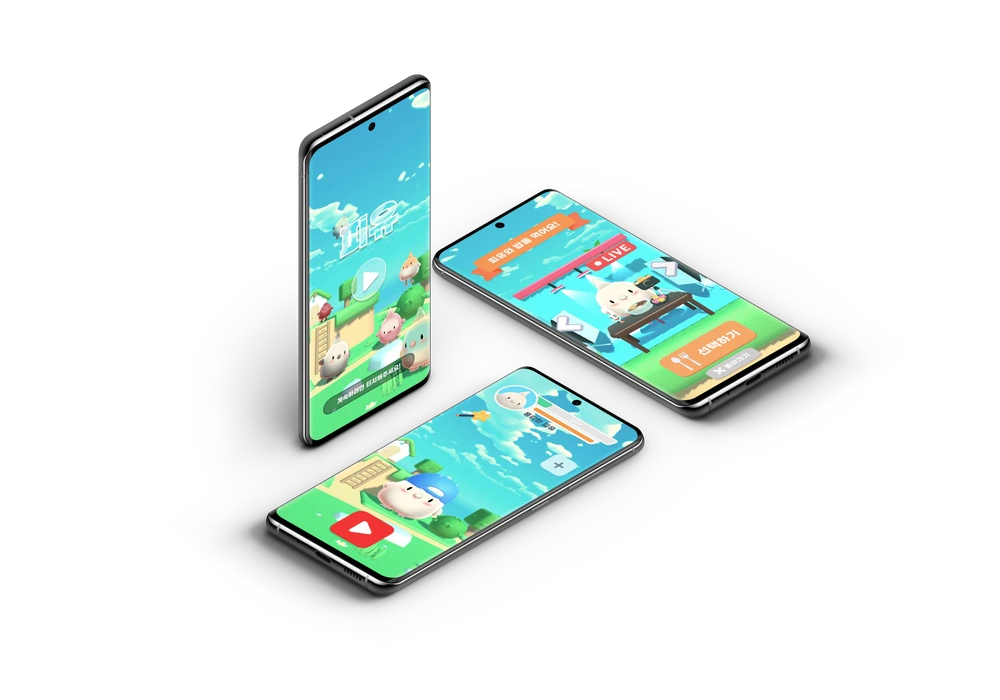

# Headfish96 · 교육·실습 지원 포트폴리오

## 개발 경험을 바탕으로 프로젝트 실습을 돕습니다

멀티캠퍼스 SSAFY 프로젝트 실습코치로 교육생의 프로젝트를 지원·지도했습니다. 현재는 LIG Defense & Aerospace C4I연구소에서 소프트웨어를 개발하며, ChatGPT·Codex를 구현과 검토 과정에 활용하고 있습니다.

**[웹 포트폴리오](https://headfish96.github.io/Headfish96/)** · [전체 개발 경험](https://headfish96.github.io/Headfish96/developer.html) · [GitHub](https://github.com/Headfish96)

## 교육 경험

### 멀티캠퍼스 · SSAFY 프로젝트 실습코치

**2023.12–2024.05**

SSAFY 수료 후 실습코치로 활동하며 교육생 프로젝트의 품질 향상을 지원·지도했습니다. 팀 프로젝트에서 기획·개발·발표를 맡았던 경험을 바탕으로 프로젝트 진행 과정에 참여했습니다.

## 실습에서 지원할 내용

- **프로젝트 진행:** 구현하려는 기능과 현재 동작을 정리하고, 다음에 확인할 작업을 함께 나눕니다.
- **오류 확인:** 화면·오류 메시지·실행 환경·입력 데이터를 읽고 문제 범위를 좁힙니다.
- **AI 협업 개발:** 작업을 구체적으로 설명하고, AI가 만든 결과를 실행·검토·수정하는 과정을 안내합니다.
- **설계와 발표:** 구현한 기능과 본인의 역할을 정리하고, 구조와 기술 선택을 설명하도록 돕습니다.

## AI를 활용한 개발 경험

### MDS · ChatGPT·Codex와 개발 중

MDS(Multimodal Data Sender)는 영상·음성·이미지를 시간축에서 시나리오로 편집하고 송신하는 도구입니다. 요구사항과 동작을 구체화하고, AI의 구현 결과를 확인하며 오류와 사용 흐름을 개선하고 있습니다.

- 시나리오 편집·저장과 데이터 미리보기
- 입력·시간 구간 사전 검사
- 시나리오 기반 송신과 실행 기록 확인

이 경험을 바탕으로 **작업 설명 → AI와 구현 → 결과 확인·수정**으로 이어지는 개발 과정을 소개합니다.

[프로젝트 상세](https://headfish96.github.io/Headfish96/projects/mds.html)

### 다른 도구·환경

| 도구·환경 | 경험 |
| --- | --- |
| Claude Code | 직접 사용하며 기본 작업 흐름 경험 |
| 로컬 GPU·EXAONE·하네스 | Codex와 함께 설치·적용 |

## 개발과 설명의 근거가 되는 프로젝트

### RS232 통신 모의 프로그램

**장비 연동 시험을 위한 Python·PyQt 데스크톱 프로그램 · 저작권 등록**

UX/UI와 소프트웨어 구조를 설계하고, 시리얼 송수신·SQLite 데이터 관리·통신 로그를 구현했습니다. View·ViewModel, Dispatcher, Repository·DAO로 역할을 나누었습니다.

포트 핸들 오류와 ACK·재전송 순서를 코드·실행 로그로 추적하고, 액티비티·시퀀스·클래스 다이어그램과 발표 자료로 설계 선택을 설명했습니다.

[프로젝트 상세](https://headfish96.github.io/Headfish96/projects/serial-simulator.html)

### PiYou · AI 적용 서비스

아동의 식사·양치 습관을 돕는 On-device AI 서비스입니다. **SSAFY 9기 자율 프로젝트 전국 1등**을 수상했습니다.

- **역할:** 6인 팀의 팀장, 기획·발표, 백엔드·AI
- **구현:** MediaPipe·Unity 적용, Convex Hull을 활용한 손동작 인식 보완, 사용자 상태 정기 갱신
- **설명 주제:** AI 인식 결과를 앱 동작에 연결하는 과정과 기술 선택

[프로젝트 상세](https://headfish96.github.io/Headfish96/projects/piyou.html) · [코드](https://github.com/Headfish96/PiYou) · [팀 소개 영상](https://youtu.be/uulgX3FKP8o)

### CodeHive · 알고리즘 스터디 플랫폼

실시간 코드 공유 편집·채점, 스터디 일정 관리, 음성통화·자료 공유를 제공한 팀 프로젝트입니다. **SSAFY 공통 프로젝트 우수상**을 수상했습니다.

- **역할:** 6인 팀의 기획·발표, 백엔드
- **설명 주제:** 학습자가 코드를 함께 읽고 문제를 해결하는 서비스의 구성

[코드](https://github.com/Headfish96/CodeHive) · [팀 소개 영상](https://youtu.be/EHhbgAoXq_k)

## 실습 지원 접근

보조강사로 참여할 때 다음 순서로 안내하겠습니다.

1. **목표와 화면 확인:** 하려던 작업, 현재 화면, 오류 메시지를 함께 읽습니다.
2. **원인 좁히기:** 실행 위치·설정·입력 데이터를 살피고 작은 단위로 확인합니다.
3. **직접 실행·재확인:** 수정 이유를 설명하고 수강생이 직접 실행해 결과를 확인하도록 돕습니다.

API 오류라면 요청 주소·방식·응답 상태를, 데이터 처리 오류라면 컬럼·자료형을 먼저 확인합니다. AI 코딩 도구의 변경 제안은 요청한 작업과 변경 내용을 함께 읽습니다.

## 실무 기반

- **LIG Defense & Aerospace C4I연구소, 2025–현재:** VxWorks RTOS 기반 미사일 체계 SW 개발·유지보수·시험평가, 서버 환경 구축 및 플랫폼 아키텍처 검토 참여
- **AWS Data Center Operations, 2024.07 입사:** 물리 서버 장애 상태 확인과 장비 교체
- **육군 통신장교, 2020–2022:** 서버 운영, 장애 대응 조율과 저장장치 증설

[RTOS / VxWorks 실무 사례](https://headfish96.github.io/Headfish96/projects/rtos.html) · [Billage · 백엔드 연동 사례](https://headfish96.github.io/Headfish96/projects/billage.html) · [인프라 연구](https://headfish96.github.io/Headfish96/projects/model-transition.html)

## 활동 가능 일정

**주말과 평일 저녁을 우선으로 참여할 수 있습니다.** 사전에 일정을 협의한 짧은 평일 교육은 휴가를 사용해 참여할 수 있습니다.

---

[개발자 포트폴리오](https://headfish96.github.io/Headfish96/developer.html) · [GitHub](https://github.com/Headfish96) · [기술 블로그](https://coder-angrybird.tistory.com/)

팀 프로젝트는 개인 담당 역할을 함께 기재했습니다. 프로젝트 화면은 팀 산출물입니다.
