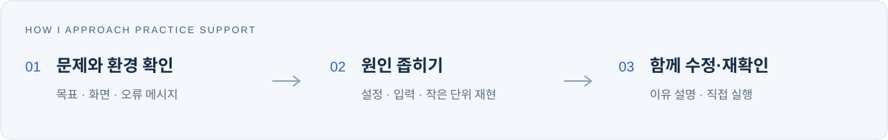
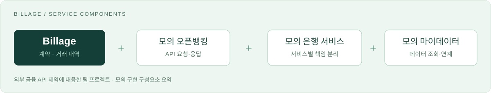
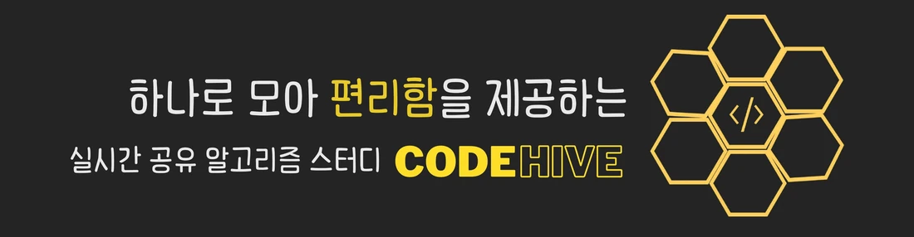

# 교육·실습 지원 포트폴리오

## 직접 만들고, 함께 풀어가는 개발자

**Headfish96 · Software Engineer / Project Coach**

멀티캠퍼스에서 SSAFY 프로젝트 실습코치로 교육생 프로젝트의 품질 향상을 지원·지도했습니다.
백엔드·인프라·AI 적용 프로젝트를 경험했으며, 2025년부터 LIG Defense & Aerospace C4I연구소에서 근무하고 있습니다.
개발 과정에서 마주한 문제를 함께 읽고, 수강생이 다음 단계를 스스로 진행할 수 있도록 돕는 보조강사로 기여하고자 합니다.

## 1. 교육 경험

**멀티캠퍼스 · SSAFY 프로젝트 실습코치 | 2023.12–2024.05**

- SSAFY 수료 후 프로젝트 실습코치로 활동
- 교육생 프로젝트의 품질 향상을 위한 지원·지도
- 기획·개발·발표 경험을 바탕으로 프로젝트 진행 과정에 참여

## 2. 생성형 AI 활용 경험

| 도구·환경 | 실제 경험 | 지원 시 설명할 범위 |
| --- | --- | --- |
| ChatGPT·Codex | AI와 협업해 MDS를 개발 중 | 요구사항을 전달하고 결과를 확인·수정하는 개발 경험 |
| Claude Code | 직접 사용해 본 경험 | 사용 경험을 바탕으로 기본 흐름 설명 |
| 로컬 GPU·EXAONE·하네스 | Codex의 도움을 받아 설치·적용 | 설치·적용 경험 소개. 상세 구성과 동작은 추가 학습 중 |

**MDS(Multimodal Data Sender)**는 시나리오를 편집하고 여러 종류의 데이터를 송신하는 도구입니다.
ChatGPT·Codex와 협업하며 요구사항을 정리하고, 시나리오 편집·송신 기능의 결과를 확인·수정하는 방식으로 개발하고 있습니다.

## 3. 대표 프로젝트

### MDS · AI 협업 개발

**Multimodal Data Sender**는 영상·음성·이미지 등을 하나의 시간축에서 시나리오로 편집하고 송신하는 도구입니다. ChatGPT·Codex와 협업해 개발 중입니다.

- **해결할 문제:** 여러 데이터의 실행 순서와 시점을 편집하고 실행 전 오류·실행 후 상태를 확인
- **주요 기능:** 시나리오 편집·저장, 데이터 미리보기, 입력·시간 구간 사전 검사, 송신과 실행 기록 확인
- **개발 방식:** 요구사항과 동작을 구체화하고, AI의 구현 결과를 확인하며 오류와 사용 흐름을 개선
- **교육과의 연결:** 작업 설명 → AI와 구현 → 결과 확인·수정으로 이어지는 개발 과정

미리보기·실제 송신·수신 확인은 서로 다른 단계로 구분합니다. 일반적인 기능만 공개합니다.

[웹 프로젝트 소개](https://headfish96.github.io/Headfish96/#mds)

### PiYou · AI 적용 서비스 개발

아동의 식사·양치 습관 개선을 돕는 OnDevice AI 서비스. **SSAFY 9기 자율 프로젝트 전국 1등.**

- **팀과 개인 역할:** 6인 팀 / 팀장, 기획·발표, 백엔드·AI
- **개발 경험:** MediaPipe와 Unity 적용, Convex Hull을 활용한 손동작 인식 보완, 사용자 상태 정기 갱신
- **교육에서 설명할 내용:** AI 인식 결과가 앱의 동작으로 이어지는 흐름, 기술 선택과 적용 과정

[저장소](https://github.com/Headfish96/PiYou) · [팀 소개 영상](https://youtu.be/uulgX3FKP8o)

### Billage · API·서비스 연동

개인 간 금전거래의 차용증 생성과 송금·상환 내역 관리를 연결한 서비스.

- **팀과 개인 역할:** 6인 팀 / 팀장, 기획·발표, 백엔드·인프라
- **개발 경험:** 외부 금융 API 이용 제약에 대응한 은행·오픈뱅킹·마이데이터 모의 구현, MSA와 Spring WebClient·WebFlux 기반 통신
- **교육에서 설명할 내용:** 요청·응답 흐름, 서비스 책임 분리, 연동 문제의 확인 순서

[저장소](https://github.com/Headfish96/Billage) · [팀 소개 영상](https://youtu.be/DxseVqu3nDE)

### CodeHive · 함께 공부하는 플랫폼

실시간 양방향 알고리즘 스터디 웹 플랫폼. **SSAFY 공통 프로젝트 우수상.**

- **팀과 개인 역할:** 6인 팀 / 기획·발표, 백엔드
- **팀 서비스 기능:** 코드 공유 편집·채점, 스터디 일정 관리, 음성통화와 자료 공유
- **교육과의 연결:** 학습자가 함께 코드를 읽고 해결할 수 있는 환경을 개발한 경험

[저장소](https://github.com/Headfish96/CodeHive) · [팀 소개 영상](https://youtu.be/EHhbgAoXq_k)

### Argus · 공개 데이터 시각화

위성 궤도·항공기 위치 공개 데이터를 3D 지구와 2D 지도에서 탐색하는 웹 프로젝트입니다.

- **구현:** TypeScript·Next.js 기반 UI, Three.js·MapLibre 모드 전환, 위성 위치 계산, 데이터 요청·캐싱과 지도 정보 표시
- **다룬 문제:** 여러 데이터 출처의 정보를 모으고, 서로 다른 렌더러를 모드별로 전환하는 구조
- **확인 범위:** 공개 코드의 구현을 소개하며 실시간 데이터 이용은 외부 API 상태에 영향을 받음

[프로젝트 소개](https://headfish96.github.io/Headfish96/#argus) · [코드](https://github.com/Headfish96/argus)

### VelocityOne Flightstick Tester · 입력 장치 진단

조이스틱의 축·버튼 입력과 연결 상태를 웹 화면에서 확인하는 Python 도구입니다.

- **구현:** Linux 입력 이벤트 읽기·축 정규화, macOS 입력 처리, FastAPI·WebSocket 상태 전달, 미연결 시 시뮬레이션 전환
- **다룬 문제:** OS별 하드웨어 입력 차이를 웹 UI의 공통 상태로 전달하는 과정
- **자료:** 공개 코드와 저장소의 시뮬레이션 모드 화면. 장치별 성능 보장 수치는 제시하지 않음

[프로젝트 소개](https://headfish96.github.io/Headfish96/#flightstick) · [코드·실행 안내](https://github.com/Headfish96/velocityone-flightstick-tester)

### maknae-order · 생활 속 주문 정리

식사·카페 주문과 인원별 예산을 정리하는 작은 PWA입니다.

- **구현:** 메뉴 사진 OCR, 인원·예산 계산, 메뉴·주문 편집, 브라우저 로컬 저장
- **사용 흐름 개선:** 사진 선택 후 자동 인식, 큰 이미지 축소, 진행 상태·오류·시간 초과 안내
- **기술:** JavaScript·Tesseract.js·PWA. OCR 정확도나 시간 절감 효과는 별도 측정하지 않음

[프로젝트 소개](https://headfish96.github.io/Headfish96/#maknae) · [코드](https://github.com/Headfish96/maknae-order)

### Kubernetes 모델 세트 전환 · 공동 연구

임무 단계에 따른 모델 세트 전환 아키텍처를 연구하고, Python·kubectl로 순차 배포와 세트 단위 적용·병렬 대기를 비교한 프로토타입을 공개했습니다.

- **공개 자료:** 원본 실험 코드·설정·결과, 결과 재집계 도구와 검증 테스트
- **구현 범위:** 모의 Deployment를 사용한 실험이며, 논문의 전체 커스텀 컨트롤러나 실제 AI 모델 통합 성능을 검증한 구현은 아님
- **연구에서 다룬 점:** 설계·구현·관측 결과를 구분하고 실험 조건과 계측 한계를 기록

[프로젝트 소개](https://headfish96.github.io/Headfish96/#model-transition) · [코드·원본 결과](https://github.com/Headfish96/tsdo-simulation)

## 4. 실습 지원 접근

아래는 보조강사로서 적용하고자 하는 안내 순서입니다.

1. **화면과 목표 확인:** 하려던 작업과 실제 화면·오류 메시지를 함께 확인합니다.
2. **환경과 원인 좁히기:** 실행 위치·설정·입력 데이터를 살피고, 가장 작은 단위로 다시 확인합니다.
3. **함께 수정하고 재실행:** 수정 이유를 설명하고 수강생이 직접 실행해 결과를 확인하도록 안내합니다.

상황별 안내 예시

- **AI 코딩 도구의 권한 요청:** 요청한 작업과 변경 범위를 함께 읽고, 의도한 작업인지 확인하도록 안내합니다.
- **데이터 분석 중 컬럼 오류:** 오류 메시지와 실제 데이터의 컬럼·자료형을 먼저 확인합니다.
- **API 연동 오류:** 주소·요청 방식·응답 상태를 순서대로 확인하며 문제 범위를 좁힙니다.

## 5. 활동 가능 일정

**주말과 평일 저녁을 우선으로 참여할 수 있습니다.** 사전에 일정을 협의한 짧은 평일 교육은 휴가를 사용해 참여할 수 있습니다.

## 6. 관련 실무 기반

- **LIG Defense & Aerospace C4I연구소, 2025–현재:** 제어 SW 개발·유지보수, 서버 환경 구축 및 플랫폼 아키텍처 검토 참여
- **AWS Data Center Operations:** 물리 서버 장애 상태 확인과 장비 교체 경험
- **육군 통신장교:** 서버 운영, 장애 대응 조율과 저장장치 증설 경험
- **Python 연구:** pandas·NumPy를 활용한 데이터 처리·분석 경험. [공개 연구 소개](../projects/quant-research.md)

---

[GitHub 프로필](https://github.com/Headfish96) · [기술 블로그](https://coder-angrybird.tistory.com/)

팀 프로젝트의 개인 역할을 구분해 작성했습니다. 프로젝트 화면은 기존 포트폴리오의 팀 산출물입니다.
