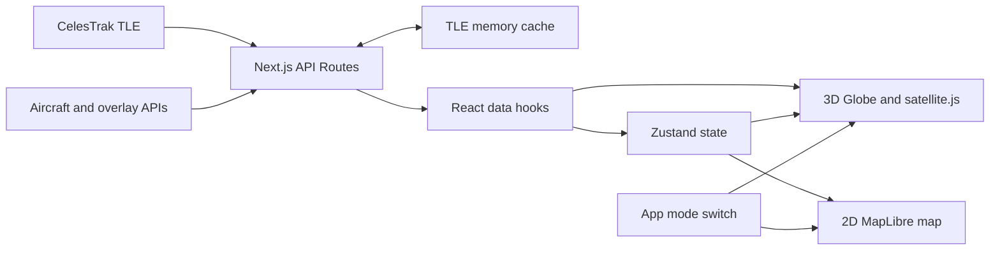

# Argus · 구조와 구현

**담당 역할:** 프로젝트 개발 · 데이터 처리·지도 UI 구성

[웹 포트폴리오](https://headfish96.github.io/Headfish96/projects/argus.html)

## 수집·상태·렌더링을 나눈 데이터 흐름

공개 코드에서 확인한 주요 모듈과 데이터 흐름을 재구성했습니다.

Mermaid 원본

## 동작 흐름

1. **위성 모드 진입** — App이 GlobeScene을 마운트하고 useSatellites가 /api/tle 배치 응답을 요청합니다.
2. **외부 조회와 캐시** — 서버는 NORAD ID별 메모리 캐시를 확인하고 필요한 TLE를 조회합니다. 결과를 ID별 JSON으로 반환합니다.
3. **좌표 계산과 UI 공유** — TLE를 SatRec으로 바꾼 뒤 매 프레임 좌표를 계산해 3D 객체를 움직이고, 위성 정보를 1초마다 Zustand에 반영합니다.
4. **항공기 모드 전환** — MapLibre 지도의 bbox에 맞춰 공개 항공기 데이터를 정규화해 저장하고, 지도와 선택 정보 패널을 갱신합니다.

## 구현에서 읽을 수 있는 설계 선택

### 3D와 2D 렌더러의 생명주기 분리

App.tsx는 위성 모드에 GlobeScene, 항공기 모드에 MapScene 하나만 마운트합니다. 모드별 렌더러와 자원 해제를 분리할 수 있지만, 재진입 시 지도 초기화와 데이터 로딩이 다시 발생합니다. 장점·비용은 구현에서 해석한 내용이며 성능 벤치마크 결과는 아닙니다.

- [src/components/App.tsx · 8-35](https://github.com/Headfish96/argus/blob/bbc70a95a379fb197c29e260f48ede94e1e21ecd/src/components/App.tsx#L8-L35)
- [src/components/map/MapScene.tsx · 629-636](https://github.com/Headfish96/argus/blob/bbc70a95a379fb197c29e260f48ede94e1e21ecd/src/components/map/MapScene.tsx#L629-L636)
- [src/components/globe/GlobeScene.tsx · 247-253](https://github.com/Headfish96/argus/blob/bbc70a95a379fb197c29e260f48ede94e1e21ecd/src/components/globe/GlobeScene.tsx#L247-L253)

### 배치 조회와 TLE 실패 캐싱

브라우저는 /api/tle를 한 번 호출하고 서버가 위성별 요청을 병렬 처리합니다. 일부 잘못된 응답도 1시간 캐싱해 반복 요청을 줄이는 구조입니다. 프로세스별 캐시이므로 재시작 시 사라지며, 일시적인 오류를 같은 시간 동안 유지할 수 있습니다.

- [src/hooks/useSatellites.ts · 15-46](https://github.com/Headfish96/argus/blob/bbc70a95a379fb197c29e260f48ede94e1e21ecd/src/hooks/useSatellites.ts#L15-L46)
- [src/app/api/tle/route.ts · 6-63](https://github.com/Headfish96/argus/blob/bbc70a95a379fb197c29e260f48ede94e1e21ecd/src/app/api/tle/route.ts#L6-L63)
- [src/app/api/tle/route.ts · 88-102](https://github.com/Headfish96/argus/blob/bbc70a95a379fb197c29e260f48ede94e1e21ecd/src/app/api/tle/route.ts#L88-L102)

### 수집과 화면 갱신의 주기 분리

항공기 수집은 10초, 화면 위치 보간은 1초 주기이며 지도 이동은 1초 debounce 후 bbox에 반영합니다. 네트워크 호출 주기와 표시 주기를 분리하지만 보간 위치는 외부에서 관측한 실제 위치가 아니라 화면용 추정입니다.

- [src/hooks/useAircraft.ts · 79-108](https://github.com/Headfish96/argus/blob/bbc70a95a379fb197c29e260f48ede94e1e21ecd/src/hooks/useAircraft.ts#L79-L108)
- [src/components/map/MapScene.tsx · 607-626](https://github.com/Headfish96/argus/blob/bbc70a95a379fb197c29e260f48ede94e1e21ecd/src/components/map/MapScene.tsx#L607-L626)
- [src/components/map/MapScene.tsx · 716-765](https://github.com/Headfish96/argus/blob/bbc70a95a379fb197c29e260f48ede94e1e21ecd/src/components/map/MapScene.tsx#L716-L765)

## 확인 범위

- 외부 API의 제공 범위와 요청 제한에 의존합니다.
- TLE 캐시는 서버 프로세스 메모리이며, 영속 데이터베이스나 공유 캐시는 구현되어 있지 않습니다.
- 항공기 보간은 화면용 추정이며 궤적 정확도·지연·렌더링 성능의 실측 근거는 없습니다.
- 별도 FastAPI·Redis·PostGIS·Jenkins·블루/그린 구성은 설계 문서에만 나타나므로 구현 아키텍처에 넣지 않았습니다.

코드 기준: [bbc70a9](https://github.com/Headfish96/argus/tree/bbc70a95a379fb197c29e260f48ede94e1e21ecd). 구조와 주요 실행 경로를 정적으로 검토했습니다.
