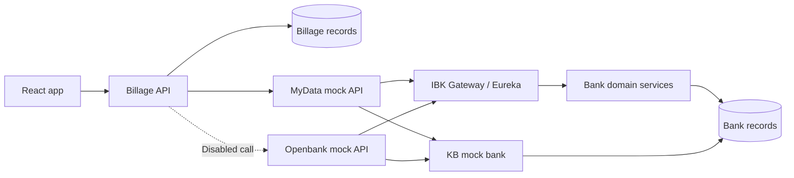

# Billage · 구조와 구현

**담당 역할:** 팀장 · 기획·발표 · 백엔드·인프라

[웹 포트폴리오](https://headfish96.github.io/Headfish96/projects/billage.html)

## 모의 금융 API를 연결한 서비스 구조

팀 프로젝트의 공개 코드에서 확인한 핵심 구성입니다. 개인 담당 역할은 위에 따로 표시했습니다.

Mermaid 원본

## 동작 흐름

1. **계약 만들기** — React API가 차용증 내용을 전송하면 ContractService가 채권자·채무자, 금액, 날짜와 계좌를 Contract로 저장하고 요청 알림을 남깁니다.
2. **계좌 목록 모으기** — 사용자 정보와 선택 은행 코드를 만든 뒤 설정 저장소의 URL로 요청합니다. MyData는 요청 로그를 남기고 각 은행의 요청 형태에 맞춰 계좌 목록을 반환합니다.
3. **계약과 거래 연결하기** — 현재 본 서비스의 transferCash는 거래를 Contract에 연결해 저장하고 상대방 알림을 만듭니다. 오픈뱅킹 HTTP 요청 코드는 주석으로 남아 있습니다.
4. **모의 이체 모듈 내부** — 별도 Openbank API에 요청이 들어오면 출금 → 입금 → 거래 저장으로 진행합니다. 은행 서비스는 계좌 상태·잔액을 확인한 후 값을 갱신합니다.

## 구현에서 읽을 수 있는 설계 선택

### 외부 금융 기능을 독립된 모의 서비스로 나누기

본 서비스, 마이데이터, 오픈뱅킹, 은행 모듈을 나눠 API 제약이 있는 환경에서도 요청·응답 형태와 서비스 역할을 구현했습니다. 은행 MSA에는 Gateway/Eureka와 사용자·계좌·이체 모듈이 있습니다.

고려할 점: 서비스별 동작을 살펴보기 쉬워지지만 URL 설정·인증 전달·배포 단위가 늘어납니다. 공개 트리에는 KB 단일/분리 버전도 공존하므로 하나의 완성 배포 토폴로지로 단정하지 않습니다.

- [MyData/Back/mydata/src/main/java/com/fin/mydata/domain/log/service/LogService.java · 33-100](https://github.com/Headfish96/Billage/blob/aa73bc02cc141cea3a43ba273bc5f2382b162de8/MyData/Back/mydata/src/main/java/com/fin/mydata/domain/log/service/LogService.java#L33-L100)
- [IBK/Back/gateway-service/src/main/resources/application.yml · 4-45](https://github.com/Headfish96/Billage/blob/aa73bc02cc141cea3a43ba273bc5f2382b162de8/IBK/Back/gateway-service/src/main/resources/application.yml#L4-L45)
- [IBK/Back/discovery-service/src/main/java/com/fin/bank/discoveryservice/DiscoveryServiceApplication.java · 7-12](https://github.com/Headfish96/Billage/blob/aa73bc02cc141cea3a43ba273bc5f2382b162de8/IBK/Back/discovery-service/src/main/java/com/fin/bank/discoveryservice/DiscoveryServiceApplication.java#L7-L12)

### 계좌 조회를 은행별로 요청하고 결과를 수집하기

Billage의 searchBank는 은행 코드 목록을 Flux.flatMap으로 요청하고 MyData는 은행별 DTO 형태로 중계합니다.

고려할 점: 요청들을 조합하지만 끝에서 blockLast()/block()으로 기다립니다. 전체 서버를 비차단 구조로 구현했다고 표현하지 않으며 응답 지연·실패가 호출자에게 영향을 줄 수 있습니다.

- [Billage/Back/billage/src/main/java/com/fin/billage/domain/transfer/service/TransferService.java · 46-96](https://github.com/Headfish96/Billage/blob/aa73bc02cc141cea3a43ba273bc5f2382b162de8/Billage/Back/billage/src/main/java/com/fin/billage/domain/transfer/service/TransferService.java#L46-L96)
- [MyData/Back/mydata/src/main/java/com/fin/mydata/domain/log/service/LogService.java · 55-100](https://github.com/Headfish96/Billage/blob/aa73bc02cc141cea3a43ba273bc5f2382b162de8/MyData/Back/mydata/src/main/java/com/fin/mydata/domain/log/service/LogService.java#L55-L100)

### 이체 단계를 출금→입금→기록 순서로 표현하기

Openbank 모듈은 출금 성공을 확인한 뒤 입금을 요청하고, 두 응답이 성공일 때 거래를 저장합니다.

고려할 점: 단계별 성공 여부는 읽기 쉽지만 입금 실패 시 원복·멱등 처리까지 보장한 구조는 아닙니다. 본 서비스의 해당 HTTP 호출은 현재 주석 처리되어 있으므로 이 모듈 구현과 종단 통합을 구분합니다.

- [openbank/src/main/java/com/fin/openbank/domain/transfer/service/TransferService.java · 22-60](https://github.com/Headfish96/Billage/blob/aa73bc02cc141cea3a43ba273bc5f2382b162de8/openbank/src/main/java/com/fin/openbank/domain/transfer/service/TransferService.java#L22-L60)
- [Billage/Back/billage/src/main/java/com/fin/billage/domain/transfer/service/TransferService.java · 164-218](https://github.com/Headfish96/Billage/blob/aa73bc02cc141cea3a43ba273bc5f2382b162de8/Billage/Back/billage/src/main/java/com/fin/billage/domain/transfer/service/TransferService.java#L164-L218)

## 확인 범위

- 은행·마이데이터·오픈뱅킹은 교육용 모의 서비스입니다.
- 점선은 현재 공개 코드에서 주석 처리된 이체 호출입니다. Openbank 모듈 구현과 본 서비스의 종단 연동을 구분했습니다.
- 실제 금융 거래, 분산 트랜잭션·멱등성 보장 및 통합 테스트 결과를 의미하지 않습니다.

코드 기준: [aa73bc0](https://github.com/Headfish96/Billage/tree/aa73bc02cc141cea3a43ba273bc5f2382b162de8). 구조와 주요 실행 경로를 정적으로 검토했습니다.
