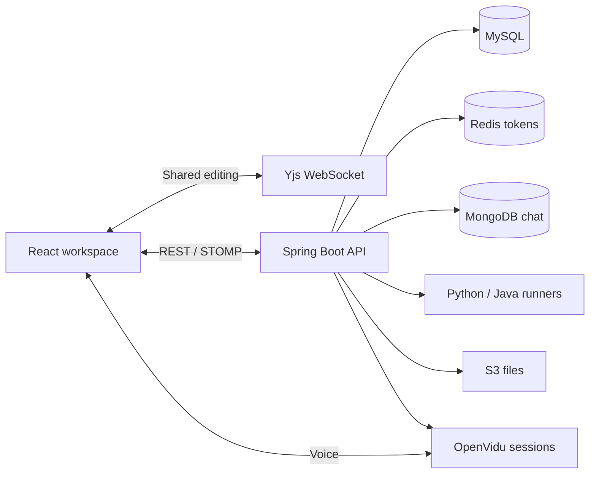

# CodeHive · 구조와 구현

**담당 역할:** 기획·발표 · 백엔드

[웹 포트폴리오](https://headfish96.github.io/Headfish96/projects/codehive.html)

## 공동 편집과 코드 실행의 서로 다른 경로

팀 프로젝트의 공개 코드에서 확인한 핵심 구성입니다. 개인 담당 역할은 위에 따로 표시했습니다.

Mermaid 원본

## 동작 흐름

1. **스터디와 참여 관계 만들기** — StudyService가 스터디의 입장 이름을 생성하고 스터디 레코드와 생성자의 참여 관계를 저장합니다. 표지 이미지가 있으면 S3에 업로드합니다.
2. **같은 코드를 함께 편집하기** — 방 ID에 code/docx 접미사를 붙여 Yjs 문서를 구분하고, CodeMirror/Quill과 provider awareness를 연결합니다.
3. **코드 실행 요청 보내기** — 프런트가 코드·입력·언어·방 ID를 /pub/run으로 전송합니다. 서버는 요청 ID를 만들고 Python 또는 Java 실행 API를 호출합니다.
4. **실행 결과를 방 전체에 공유하기** — SocketController가 응답을 /sub/run/{roomId}로 전송하면 프런트는 성공·실패 상태와 출력을 터미널에 보여줍니다.

## 구현에서 읽을 수 있는 설계 선택

### 편집 동기화와 채팅·실행 메시지의 경로 분리

코드·문서는 Yjs+CodeMirror/Quill로 동기화하고, 채팅·공지·코드 실행 결과는 Spring STOMP의 방별 채널로 전달합니다.

고려할 점: 역할에 맞는 도구를 쓰지만 Yjs와 STOMP의 연결 상태·방 식별자를 함께 관리해야 합니다. 동시 접속 수나 충돌 복구 성능은 공개 자료로 입증하지 않습니다.

- [FE/src/pages/AppIDE.jsx · 81-151](https://github.com/Headfish96/CodeHive/blob/566a804c06289a0c932ab038e88f823ef9981b86/FE/src/pages/AppIDE.jsx#L81-L151)
- [BE/src/main/java/com/spoon/sok/domain/socket/controller/SocketController.java · 20-44](https://github.com/Headfish96/CodeHive/blob/566a804c06289a0c932ab038e88f823ef9981b86/BE/src/main/java/com/spoon/sok/domain/socket/controller/SocketController.java#L20-L44)
- [BE/src/main/java/com/spoon/sok/config/WebSocketConfig.java · 16-25](https://github.com/Headfish96/CodeHive/blob/566a804c06289a0c932ab038e88f823ef9981b86/BE/src/main/java/com/spoon/sok/config/WebSocketConfig.java#L16-L25)

### 언어별 실행기를 서비스 밖으로 분리

Spring은 코드·입력·요청 ID를 만들어 Python/Java 실행 API로 전달하고, 받은 결과를 같은 스터디방에 방송합니다.

고려할 점: 실행 환경을 구분할 수 있지만 현재 호출은 RestTemplate 동기 요청입니다. 공개 실행기에는 시간 제한이 있으나 별도 보안 격리나 자동 정답 비교 채점은 확인되지 않습니다.

- [BE/src/main/java/com/spoon/sok/domain/socket/service/CodeExecuteService.java · 21-42](https://github.com/Headfish96/CodeHive/blob/566a804c06289a0c932ab038e88f823ef9981b86/BE/src/main/java/com/spoon/sok/domain/socket/service/CodeExecuteService.java#L21-L42)
- [BE/src/main/java/com/spoon/sok/domain/socket/controller/SocketController.java · 36-40](https://github.com/Headfish96/CodeHive/blob/566a804c06289a0c932ab038e88f823ef9981b86/BE/src/main/java/com/spoon/sok/domain/socket/controller/SocketController.java#L36-L40)
- [Compile/JAVA/src/main/java/com/java/compile/CompileService.java · 69-115](https://github.com/Headfish96/CodeHive/blob/566a804c06289a0c932ab038e88f823ef9981b86/Compile/JAVA/src/main/java/com/java/compile/CompileService.java#L69-L115)
- [Compile/PYTHON/Interpreter.py · 16-45](https://github.com/Headfish96/CodeHive/blob/566a804c06289a0c932ab038e88f823ef9981b86/Compile/PYTHON/Interpreter.py#L16-L45)

### 데이터 성격에 맞춰 저장 위치 분리

관계 데이터는 MySQL/JPA, 채팅은 MongoDB, 토큰은 TTL이 있는 Redis, 업로드 본문은 S3와 메타데이터 저장소로 나눴습니다.

고려할 점: 사용 목적이 분명하지만 구성할 저장소가 늘고, 자료 파일 업로드와 DB 메타데이터 변경의 실패 처리도 따로 관리해야 합니다.

- [BE/src/main/java/com/spoon/sok/domain/socket/service/ChatService.java · 23-42](https://github.com/Headfish96/CodeHive/blob/566a804c06289a0c932ab038e88f823ef9981b86/BE/src/main/java/com/spoon/sok/domain/socket/service/ChatService.java#L23-L42)
- [BE/src/main/java/com/spoon/sok/domain/user/service/UserService.java · 74-77](https://github.com/Headfish96/CodeHive/blob/566a804c06289a0c932ab038e88f823ef9981b86/BE/src/main/java/com/spoon/sok/domain/user/service/UserService.java#L74-L77)
- [BE/src/main/java/com/spoon/sok/domain/study/service/StudyFileUploadService.java · 46-70](https://github.com/Headfish96/CodeHive/blob/566a804c06289a0c932ab038e88f823ef9981b86/BE/src/main/java/com/spoon/sok/domain/study/service/StudyFileUploadService.java#L46-L70)
- [BE/src/main/java/com/spoon/sok/aws/S3Service.java · 37-55](https://github.com/Headfish96/CodeHive/blob/566a804c06289a0c932ab038e88f823ef9981b86/BE/src/main/java/com/spoon/sok/aws/S3Service.java#L37-L55)

## 확인 범위

- 팀 전체 서비스 구조이며 개인 담당은 기획·발표·백엔드입니다.
- 공개 코드에서 확인되는 기능은 코드 실행·결과 공유입니다. 자동 정답 비교 채점, 실행기 보안 격리 및 부하 성능은 검증 범위에 포함하지 않았습니다.
- 외부 서비스의 현재 배포 상태와 통합 실행은 재검증하지 않았습니다.

코드 기준: [566a804](https://github.com/Headfish96/CodeHive/tree/566a804c06289a0c932ab038e88f823ef9981b86). 구조와 주요 실행 경로를 정적으로 검토했습니다.
