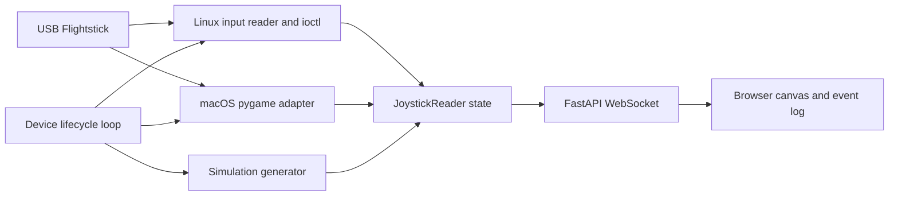

# VelocityOne Flightstick Tester · 구조와 구현

**담당 역할:** 프로젝트 개발 · 입력 처리·웹 상태 전달·진단 화면 구성

[웹 포트폴리오](https://headfish96.github.io/Headfish96/projects/flightstick.html)

## 장치 입력에서 브라우저 관측까지

공개 코드에서 확인한 주요 모듈과 데이터 흐름을 재구성했습니다.

Mermaid 원본

## 동작 흐름

1. **애플리케이션 시작** — 런처가 Uvicorn을 background thread로 시작하고 /api/status 확인 후 브라우저를 엽니다.
2. **입력 취득** — Linux에서는 읽을 수 있는 event 노드별 스레드를 시작하고 원시 이벤트를 변환합니다. macOS에서는 pygame으로 장치 상태를 읽습니다.
3. **공통 상태 전송** — get_state가 공통 JSON 상태를 제공하고 WebSocket endpoint가 현재 snapshot을 주기적으로 전송합니다.
4. **관측과 재연결** — 프론트엔드가 연결/시뮬레이션 상태, 축·버튼·마지막 이벤트를 표시하고 소켓이 닫히면 재연결합니다.

## 구현에서 읽을 수 있는 설계 선택

### 운영체제 입력을 공통 상태로 변환

Linux는 /dev/input 이벤트와 ioctl을 사용하고 macOS는 optional pygame을 사용합니다. 동일한 axes·buttons 상태로 변환해 웹 UI를 공유하지만 장치 매핑과 권한, 운영체제별 동작은 별도로 확인해야 합니다.

- [joystick_reader.py · 207-289](https://github.com/Headfish96/velocityone-flightstick-tester/blob/733b3aacf7859f8cf39b68ed045dd31177ad919b/joystick_reader.py#L207-L289)
- [joystick_reader.py · 294-357](https://github.com/Headfish96/velocityone-flightstick-tester/blob/733b3aacf7859f8cf39b68ed045dd31177ad919b/joystick_reader.py#L294-L357)
- [joystick_reader.py · 448-458](https://github.com/Headfish96/velocityone-flightstick-tester/blob/733b3aacf7859f8cf39b68ed045dd31177ad919b/joystick_reader.py#L448-L458)

### 이벤트 수신과 화면 전송을 분리

Linux 장치별 worker thread가 최신 값을 갱신하고 FastAPI는 각 클라이언트에 약 30Hz로 상태 snapshot을 보냅니다. UI는 단순해지지만 모든 이벤트를 손실 없이 기록하는 스트림은 아닙니다. last_event 하나와 브라우저의 최대 50개 로그로는 완전한 이벤트 이력을 보장하지 않습니다.

- [joystick_reader.py · 227-289](https://github.com/Headfish96/velocityone-flightstick-tester/blob/733b3aacf7859f8cf39b68ed045dd31177ad919b/joystick_reader.py#L227-L289)
- [main.py · 44-61](https://github.com/Headfish96/velocityone-flightstick-tester/blob/733b3aacf7859f8cf39b68ed045dd31177ad919b/main.py#L44-L61)
- [static/app.js · 75-85](https://github.com/Headfish96/velocityone-flightstick-tester/blob/733b3aacf7859f8cf39b68ed045dd31177ad919b/static/app.js#L75-L85)
- [static/app.js · 191-201](https://github.com/Headfish96/velocityone-flightstick-tester/blob/733b3aacf7859f8cf39b68ed045dd31177ad919b/static/app.js#L191-L201)

### 하드웨어 없는 화면 확인 경로

장치가 없으면 시뮬레이션을 생성하고 simulation_mode를 UI 배지로 표시합니다. 하드웨어 없이 상태 전달·화면 구성을 확인할 수 있지만 실제 장치의 정확도·연결 지연을 검증하는 테스트는 별도입니다.

- [joystick_reader.py · 362-446](https://github.com/Headfish96/velocityone-flightstick-tester/blob/733b3aacf7859f8cf39b68ed045dd31177ad919b/joystick_reader.py#L362-L446)
- [static/app.js · 128-144](https://github.com/Headfish96/velocityone-flightstick-tester/blob/733b3aacf7859f8cf39b68ed045dd31177ad919b/static/app.js#L128-L144)

## 확인 범위

- 약 30Hz 상태 전달은 코드상의 주기이며 실측 지연이나 프레임률 보장 수치가 아닙니다.
- Linux 입력 장치 읽기 권한과 macOS pygame 설치가 필요합니다.
- last_event snapshot 구조로 모든 하드웨어 이벤트의 순서·유실 없는 기록을 보장하지 않습니다.
- 공개 저장소만으로 오프라인 의존성 패키지와 모든 운영체제/장치 조합의 동작은 확인할 수 없습니다.

코드 기준: [733b3aa](https://github.com/Headfish96/velocityone-flightstick-tester/tree/733b3aacf7859f8cf39b68ed045dd31177ad919b). 구조와 주요 실행 경로를 정적으로 검토했습니다.
