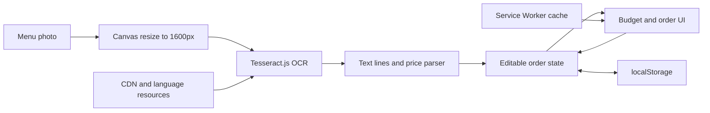

# maknae-order · 구조와 구현

**담당 역할:** 프로젝트 개발 · 주문 흐름·OCR·예산 처리 구현

[웹 포트폴리오](https://headfish96.github.io/Headfish96/projects/maknae.html)

## 브라우저 안에서 끝나는 주문 처리

공개 코드에서 확인한 주요 모듈과 데이터 흐름을 재구성했습니다.

Mermaid 원본

## 동작 흐름

1. **사진 선택·축소** — 이미지를 선택하면 FileReader와 Canvas로 최대 1600px JPEG를 만들고 저장 후 자동으로 OCR을 시작합니다.
2. **문자 인식·후보 생성** — kor+eng 인식을 수행하고 각 줄의 이름·가격 후보를 화면에 표시합니다. 진행·오류·시간 초과 메시지도 표시합니다.
3. **주문 확인·계산** — 사용자가 후보를 추가하거나 직접 메뉴를 편집하면 저장과 예산 요약을 갱신합니다.
4. **재방문·주문 전달** — localStorage에서 상태를 복원하고, 카페 주문은 Clipboard API로 복사하며 실패 시 텍스트를 alert로 표시합니다.

## 구현에서 읽을 수 있는 설계 선택

### 브라우저 안에서 OCR과 주문 처리

사진을 브라우저에서 축소한 후 Tesseract.js로 인식하고 주문 데이터를 localStorage에 저장합니다. 별도 앱 서버 없이 구성할 수 있지만 브라우저 저장 한도와 기기별 OCR 처리 비용을 고려해야 합니다.

- [app.js · 20-33](https://github.com/Headfish96/maknae-order/blob/e2672c97ebacbef4a433cb34a60d81d0375b8984/app.js#L20-L33)
- [app.js · 95-145](https://github.com/Headfish96/maknae-order/blob/e2672c97ebacbef4a433cb34a60d81d0375b8984/app.js#L95-L145)
- [app.js · 184-194](https://github.com/Headfish96/maknae-order/blob/e2672c97ebacbef4a433cb34a60d81d0375b8984/app.js#L184-L194)

### OCR 결과를 편집 가능한 후보로 제공

인식된 줄과 가격 후보를 보여주고 사용자가 추가·수정하도록 구성했습니다. 자동 확정의 오류 영향을 줄일 수 있지만 최종 메뉴·가격은 사용자의 확인이 필요합니다.

- [app.js · 223-261](https://github.com/Headfish96/maknae-order/blob/e2672c97ebacbef4a433cb34a60d81d0375b8984/app.js#L223-L261)
- [app.js · 283-335](https://github.com/Headfish96/maknae-order/blob/e2672c97ebacbef4a433cb34a60d81d0375b8984/app.js#L283-L335)

### 업데이트 우선 캐싱과 오프라인 재방문

Service Worker가 앱 shell을 선캐싱하고 network-first로 요청합니다. 접속 시 새 버전을 받기 쉽지만 오프라인 OCR까지 보장하는 구조는 아닙니다. CDN·언어 리소스의 최초 로딩 상태에 영향을 받습니다.

- [sw.js · 1-29](https://github.com/Headfish96/maknae-order/blob/e2672c97ebacbef4a433cb34a60d81d0375b8984/sw.js#L1-L29)
- [index.html · 167-173](https://github.com/Headfish96/maknae-order/blob/e2672c97ebacbef4a433cb34a60d81d0375b8984/index.html#L167-L173)
- [app.js · 147-176](https://github.com/Headfish96/maknae-order/blob/e2672c97ebacbef4a433cb34a60d81d0375b8984/app.js#L147-L176)

## 확인 범위

- 메뉴 사진의 인식 결과와 가격은 사용자가 확인·수정해야 합니다.
- localStorage는 브라우저·기기별로 분리되며 사진 저장량 한도에 영향을 받습니다.
- OCR 엔진·언어 리소스 최초 로딩에는 네트워크가 필요할 수 있습니다.
- 시간 초과는 Promise.race로 안내하지만 진행 중 OCR worker를 명시적으로 중단하는 코드는 없습니다.

코드 기준: [e2672c9](https://github.com/Headfish96/maknae-order/tree/e2672c97ebacbef4a433cb34a60d81d0375b8984). 구조와 주요 실행 경로를 정적으로 검토했습니다.
