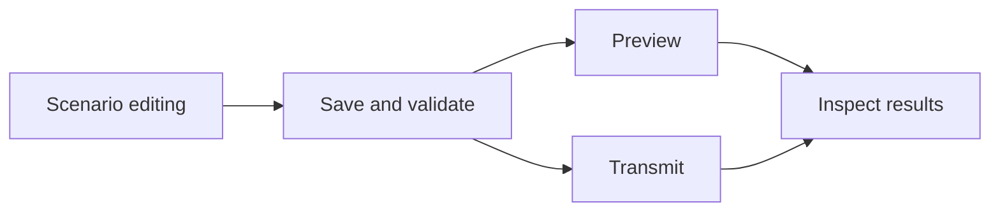

# MDS · Multimodal Data Sender · 구조와 구현

**담당 역할:** 요구사항 구체화 · AI 구현 결과 확인 · 오류·사용 흐름 개선

[웹 포트폴리오](https://headfish96.github.io/Headfish96/projects/mds.html)

## 시나리오를 편집하고 실행 결과를 확인하는 흐름

공개가 허용된 일반 기능 흐름입니다. 내부 SW 아키텍처·프로토콜·화면은 포함하지 않았습니다.

Mermaid 원본

## 동작 흐름

1. **요구사항을 시나리오로 정리** — 영상·음성·이미지 등 데이터를 시간 흐름에 맞춰 편집합니다.
2. **저장하고 검증** — 저장한 시나리오를 검증하고 미리보기로 내용을 확인합니다.
3. **실행 결과 확인** — 송신과 실행 로그를 살펴보고 필요한 수정으로 이어갑니다.
## 확인 범위

- 일반 기능 흐름과 AI 협업 개발 과정을 소개합니다. 업무 관련 내부 프로토콜·코드·화면은 공개하지 않습니다.
