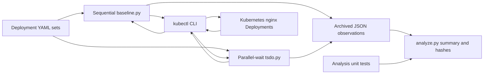

# Kubernetes 모델 세트 전환 연구 · 구조와 구현

**담당 역할:** 모델 세트 전환 아키텍처 공동 연구 · 프로토타입·실험 결과 정리

[웹 포트폴리오](https://headfish96.github.io/Headfish96/projects/model-transition.html)

## 배포 실행과 결과 분석을 분리한 실험

공개 코드에서 확인한 주요 모듈과 데이터 흐름을 재구성했습니다.

Mermaid 원본

## 동작 흐름

1. **모의 workload 정의** — nginx Deployment 세트를 YAML로 정의하고 초기 세트가 Available 상태가 되도록 준비합니다.
2. **두 전환 절차 실행** — 순차 적용·대기와 세트 단위 적용·병렬 대기를 별도 Python 스크립트로 실행하도록 구성했습니다.
3. **관측 결과 보존** — 각 방식의 총 전환 시간과 부분 구간 관측값을 10회씩 JSON으로 기록했습니다.
4. **재집계와 범위 확인** — 별도 분석 도구가 원본 JSON을 재집계하고 유효성·파일 해시를 확인합니다. 부분 구간 정의 차이도 명시합니다.

## 구현에서 읽을 수 있는 설계 선택

### 배포 요청과 준비 대기를 비교 단위로 분리

기준 방식은 Deployment별 적용·대기를 반복하고, 비교 방식은 세트 YAML 적용 뒤 Available을 병렬 대기합니다. 여러 준비 대기를 겹칠 수 있지만 다중 문서 apply는 원자적 트랜잭션이 아니며 두 스크립트의 처리 순서도 다릅니다.

- [legacy/scripts/baseline.py · 163-188](https://github.com/Headfish96/tsdo-simulation/blob/38aa9bd127030538a274e24978b20a30500d0613/legacy/scripts/baseline.py#L163-L188)
- [legacy/scripts/tsdo.py · 46-65](https://github.com/Headfish96/tsdo-simulation/blob/38aa9bd127030538a274e24978b20a30500d0613/legacy/scripts/tsdo.py#L46-L65)
- [legacy/scripts/tsdo.py · 108-118](https://github.com/Headfish96/tsdo-simulation/blob/38aa9bd127030538a274e24978b20a30500d0613/legacy/scripts/tsdo.py#L108-L118)

### 실행 아카이브와 결과 재집계를 분리

기존 측정 스크립트와 JSON은 legacy에 보존하고 analyze.py는 파일 읽기만 수행합니다. 클러스터를 조작하지 않고 수치를 검산할 수 있으나 기존 기록에 없는 실행 환경·이벤트 로그를 복구할 수는 없습니다.

- [tools/analyze.py · 32-47](https://github.com/Headfish96/tsdo-simulation/blob/38aa9bd127030538a274e24978b20a30500d0613/tools/analyze.py#L32-L47)
- [README.md · 29-41](https://github.com/Headfish96/tsdo-simulation/blob/38aa9bd127030538a274e24978b20a30500d0613/README.md#L29-L41)

### 실패 복구 시도와 성공 검증을 구분

비교 스크립트는 Available 대기 실패 시 새 세트 삭제와 이전 YAML 재적용을 시도합니다. 복구 완료를 기다리거나 실패를 주입하는 테스트는 없어 롤백 보장으로 소개할 수 없습니다.

- [legacy/scripts/tsdo.py · 68-72](https://github.com/Headfish96/tsdo-simulation/blob/38aa9bd127030538a274e24978b20a30500d0613/legacy/scripts/tsdo.py#L68-L72)
- [legacy/scripts/tsdo.py · 120-134](https://github.com/Headfish96/tsdo-simulation/blob/38aa9bd127030538a274e24978b20a30500d0613/legacy/scripts/tsdo.py#L120-L134)
- [README.md · 64-79](https://github.com/Headfish96/tsdo-simulation/blob/38aa9bd127030538a274e24978b20a30500d0613/README.md#L64-L79)

## 확인 범위

- 공동 연구의 프로토타입이며 논문에서 제안한 전체 custom controller 구현은 아닙니다.
- 실제 AI 모델 대신 nginx Deployment를 사용하며 무중단 전환·실제 모델 성능을 검증하지 않았습니다.
- 두 방식의 부분 전환 구간 정의가 달라 해당 지표의 감소율을 동일 조건 비교로 사용할 수 없습니다.
- 기존 JSON의 실행 환경·개별 이벤트 로그가 없고, 수렴도 그림은 실측 시계열이 아닌 도식입니다.

코드 기준: [38aa9bd](https://github.com/Headfish96/tsdo-simulation/tree/38aa9bd127030538a274e24978b20a30500d0613). 구조와 주요 실행 경로를 정적으로 검토했습니다.
