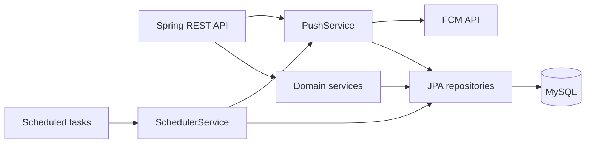

# PiYou · 구조와 구현

**담당 역할:** 팀장 · 기획·발표 · 백엔드·AI

[웹 포트폴리오](https://headfish96.github.io/Headfish96/projects/piyou.html)

## 요청 처리와 예약 작업이 만나는 백엔드

팀 프로젝트의 공개 코드에서 확인한 핵심 구성입니다. 개인 담당 역할은 위에 따로 표시했습니다.

Mermaid 원본

## 동작 흐름

1. **아이 생성** — ChildController가 요청을 받아 ChildService로 전달하고, 상태와 기본 수집 항목을 저장한 뒤 응답 DTO를 반환합니다.
2. **활동 결과 반영** — 아이 수정 요청에 경험치 값이 있으면 경험치를 합산하고 isMeal을 true로 바꾼 뒤 저장합니다.
3. **시간 경과 반영** — 예약 작업이 미식사 아이의 경험치를 줄이고 별도 시각에 식사 여부를 초기화합니다. 변경은 JPA EntityManager로 flush합니다.
4. **알림 발송** — 매분 알림 대상 조회 → 아이 토큰을 포함한 PushRequest 생성 → FCM HTTP POST 순서로 실행됩니다.

## 구현에서 읽을 수 있는 설계 선택

### 요청 처리와 정기 갱신을 분리

앱의 아이·도감 요청은 서비스 계층으로, 시간에 따라 변하는 식사 상태·알림은 SchedulerService로 분리했습니다. 두 경로는 같은 JPA 저장소를 사용합니다.

고려할 점: 시간 규칙을 한곳에서 읽기 쉬운 대신, 다중 인스턴스에서 작업 중복 실행을 막는 별도 조정은 공개 코드에서 확인되지 않습니다.

- [backend/spring-server/src/main/java/com/b106_402jeoung/PIYOU/controller/SchedulerController.java · 15-30](https://github.com/Headfish96/PiYou/blob/1d89d7054d8c1999254e46023baa75f32747c003/backend/spring-server/src/main/java/com/b106_402jeoung/PIYOU/controller/SchedulerController.java#L15-L30)
- [backend/spring-server/src/main/java/com/b106_402jeoung/PIYOU/service/SchedulerService.java · 19-57](https://github.com/Headfish96/PiYou/blob/1d89d7054d8c1999254e46023baa75f32747c003/backend/spring-server/src/main/java/com/b106_402jeoung/PIYOU/service/SchedulerService.java#L19-L57)

### 여러 레코드 변경을 트랜잭션 단위로 묶기

아이 생성 시 상태·초기 캐릭터·모자 수집 항목을 함께 만들고, 정기 갱신은 설정한 batch_size마다 flush한 뒤 마지막에 clear합니다.

고려할 점: 묶음 갱신의 의도는 코드에서 확인되지만 대상 전체를 List로 읽습니다. 청크 조회나 처리량 개선 수치는 검증하지 않았습니다.

- [backend/spring-server/src/main/java/com/b106_402jeoung/PIYOU/service/ChildService.java · 25-51](https://github.com/Headfish96/PiYou/blob/1d89d7054d8c1999254e46023baa75f32747c003/backend/spring-server/src/main/java/com/b106_402jeoung/PIYOU/service/ChildService.java#L25-L51)
- [backend/spring-server/src/main/java/com/b106_402jeoung/PIYOU/service/SchedulerService.java · 25-57](https://github.com/Headfish96/PiYou/blob/1d89d7054d8c1999254e46023baa75f32747c003/backend/spring-server/src/main/java/com/b106_402jeoung/PIYOU/service/SchedulerService.java#L25-L57)

### 알림 시각과 실제 발송을 별도 모델로 다루기

아이와 Notification을 ChildNoti로 연결하고, 분 단위 조회에서 선택한 대상의 토큰으로 FCM 메시지를 보냅니다.

고려할 점: 설정 조회와 발송을 설명하기 쉽지만, 현재 발송 코드는 동기 HTTP 호출입니다. 실패 재시도·중복 방지·현재 FCM API 호환성은 별도 확인이 필요합니다.

- [backend/spring-server/src/main/java/com/b106_402jeoung/PIYOU/entity/ChildNoti.java · 15-27](https://github.com/Headfish96/PiYou/blob/1d89d7054d8c1999254e46023baa75f32747c003/backend/spring-server/src/main/java/com/b106_402jeoung/PIYOU/entity/ChildNoti.java#L15-L27)
- [backend/spring-server/src/main/java/com/b106_402jeoung/PIYOU/repository/ChildNotiRepository.java · 15-17](https://github.com/Headfish96/PiYou/blob/1d89d7054d8c1999254e46023baa75f32747c003/backend/spring-server/src/main/java/com/b106_402jeoung/PIYOU/repository/ChildNotiRepository.java#L15-L17)
- [backend/spring-server/src/main/java/com/b106_402jeoung/PIYOU/service/PushService.java · 39-97](https://github.com/Headfish96/PiYou/blob/1d89d7054d8c1999254e46023baa75f32747c003/backend/spring-server/src/main/java/com/b106_402jeoung/PIYOU/service/PushService.java#L39-L97)

## 확인 범위

- 구조도는 공개 백엔드 코드 범위입니다. Unity 패키지 내부 구현은 저장소에 남아 있지 않아 포함하지 않았습니다.
- SSAFY 전국 1등은 팀 수상입니다. 서버·DB·FCM 연동의 현재 실행 상태나 처리량을 재측정하지 않았습니다.

코드 기준: [1d89d70](https://github.com/Headfish96/PiYou/tree/1d89d7054d8c1999254e46023baa75f32747c003). 구조와 주요 실행 경로를 정적으로 검토했습니다.
