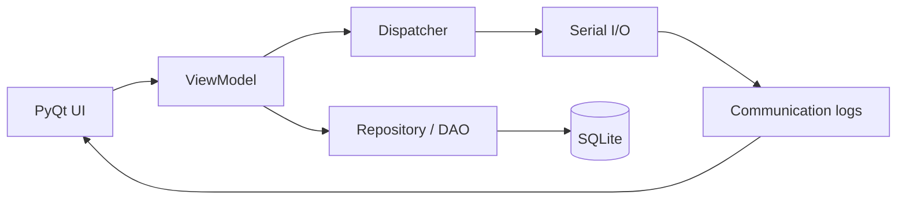

# RS232 통신 모의 프로그램 · 구조와 구현

**담당 역할:** UX/UI · 소프트웨어 구조 설계 · 통신·데이터 처리 · 오류 분석

[웹 포트폴리오](https://headfish96.github.io/Headfish96/projects/serial-simulator.html)

## 화면·통신·저장을 나눈 구성 개념도

설계 설명과 일부 구현 기록을 바탕으로 정리한 개념 구성도입니다.

Mermaid 원본

## 동작 흐름

1. **화면에서 작업 입력** — PyQt 화면에서 통신과 데이터 작업을 입력하고 ViewModel을 통해 처리합니다.
2. **통신과 저장의 책임 분리** — 비동기 통신은 Dispatcher, 데이터 접근은 Repository/DAO 구조로 구분했습니다.
3. **로그로 상태 확인** — 송신·수신·재전송·ACK 기록을 확인하며 포트 핸들 오류와 중복 ACK를 분석했습니다.

## 구현에서 읽을 수 있는 설계 선택

### UI와 처리 책임 분리

MVVM과 계층 구조를 적용해 화면 동작과 통신·데이터 처리의 역할을 구분했습니다.

고려할 점: 컴포넌트 간 상태와 이벤트의 전달 규칙을 일관되게 유지해야 합니다.

### 통신 흐름을 관찰 가능한 기록으로 만들기

송수신·ACK·재전송 로그와 분리·결합 가능한 로그 창을 구현했습니다.

고려할 점: 송수신과 재전송 기록을 함께 읽어야 포트 연결 문제와 응답 처리 문제를 구분할 수 있습니다.

## 확인 범위

- 업무 산출물의 전체 소스, 내부 프로토콜·원시 로그·체계 세부 구성은 공개하지 않습니다.
- 저작권 등록된 프로그램이며, 이 페이지는 설계·구현 기여를 소개합니다.
